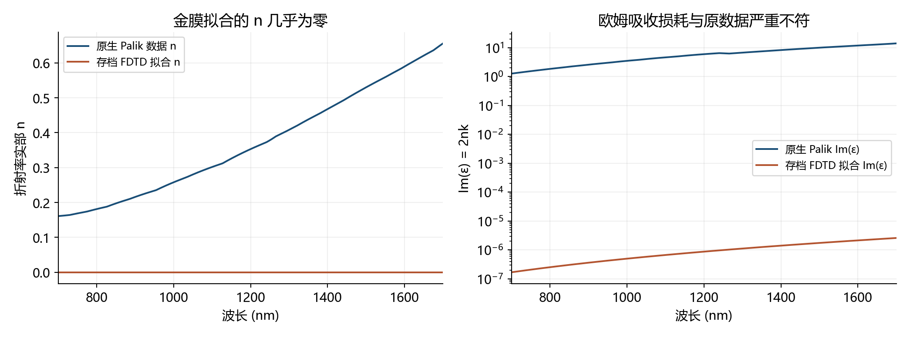
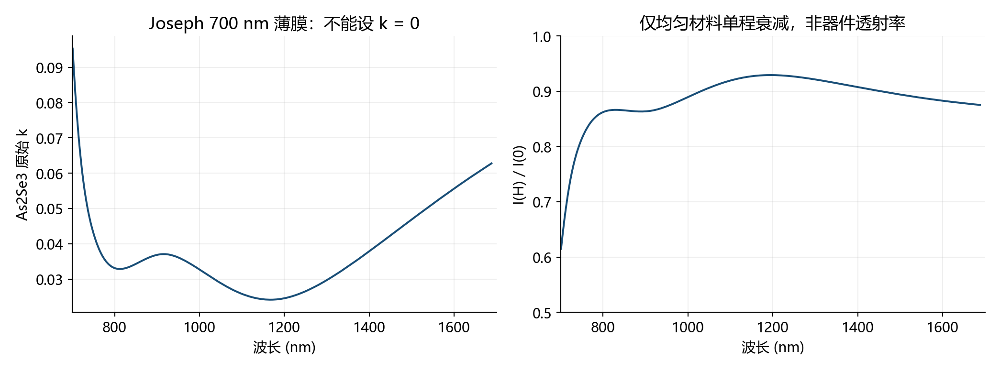
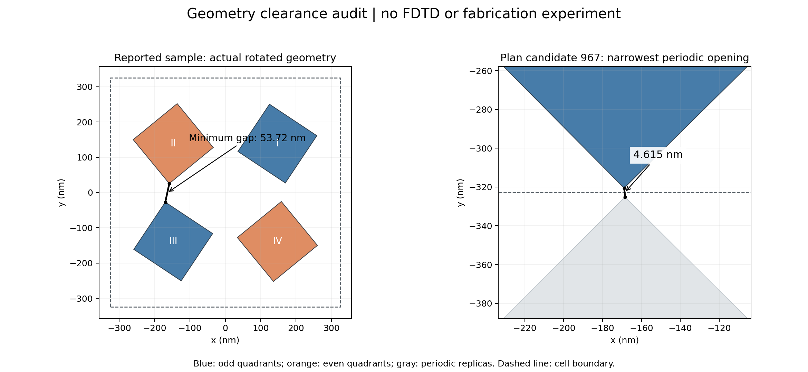
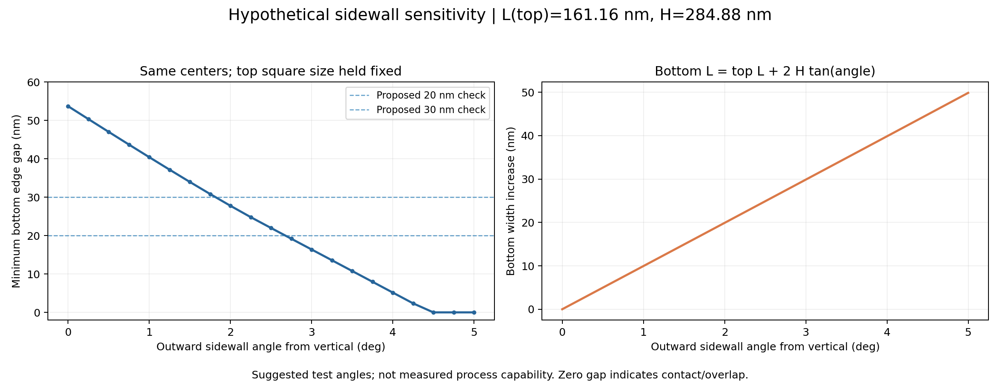
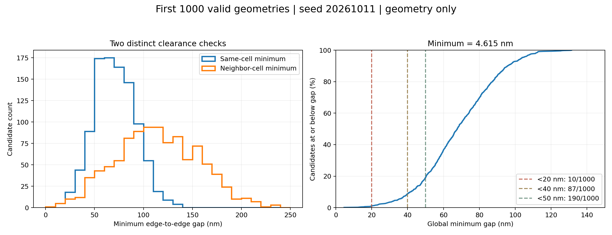

# As₂Se₃ / Au 四聚体器件的可行性与可加工性调研

2026-10-18 · 当前目标：厚 SiO₂ / Au 100 nm / As₂Se₃ 四聚体 · 层序从下到上

[下载 PDF](../../output/pdf/device_feasibility_2026-10-18.pdf) · [原生材料复核](data/native_material_audit.json) · [几何审查数据](data/geometry_audit.json)

## 结论与建议

**结论是“有条件可行，值得做工艺小样；目前不足以确认目标光谱性能，更不宜直接按现有仿真结果投片”。** 同材料 Au/As₂Se₃ 薄膜叠层、As₂Se₃ 干刻和纳米图形化都有实验依据，但未找到完整复现本器件层序、161 nm 方柱和双谷指标的实验文献。

> 关键更正：只读重开已保存的实际 FSP 后确认，当前 Au 拟合的欧姆损耗几乎丢失。旧报告中的谱线是该数值模型的真实输出，不能视为真实 Au100 器件的性能预测。先前仅标注“拟合未认证”不够充分；关于金层位置优劣、谷深、Q 与场增强的判断都需要在材料修正后重新验证。

| 判断对象 | 当前结论 | 依据与缺口 |
| --- | --- | --- |
| 做出这类叠层与纳米图形 | 有实验基础，需本平台工艺开发 | Au 上 As₂Se₃ 膜及同材料刻蚀已有先例；纳米柱/Au 停止层尚待验证 |
| 获得反射/吸收型共振 | 物理路线合理 | 介电谐振体直接置于金镜有实验先例；当前材料拟合不合格 |
| 精确实现两个指定谷、高 Q | 尚未证实 | 缺真实材料损耗、模式识别、工艺容差及测量对照 |
| 连续 Au100 下实现高透射 | 架构约束明显 | 厚连续金镜通常用于抑制透射；不能靠取消玻璃背面空气来保证高透射 |
| 现有随机候选全部可加工 | 不成立 | 1000 个合法候选中最小真实间隙约 4.615 nm |

建议顺序：**校准 Au 材料模型 → 同批 As₂Se₃ 见证膜表征 → 加工间隙与形貌约束 → 小规模鲁棒优化 → 工艺小样和光谱验证。** 已生成数据保留作流程测试或模型对照，不以本次发现为由删除原数据。本次未修改生成器、未运行新的时间推进仿真。

本报告以一手论文、作者公开原文、官方求解器文档和供应商 SDS 为依据。下文把文献实验、类比证据、本地计算和建议试验分别标明；不提供未经询价的成本、周期或良率数字。

<!-- PAGEBREAK -->

## 1. 首要问题：本机 Au 拟合几乎丢失 Palik 输入损耗

### 1.1 已完成的只读复核

在独立隐藏会话中加载原始 `sample0.fsp`，未执行 run、save、switchtolayout 或材料修改；原生版本 8.31.3633，源波段 700–1700 nm。FSP 的 SHA256 前后均为 `d2b170f34974999e81540595c962419ec98beb63422d44cdc7d034c56aeba053`。

`getindex` 读回原生 Palik 数据，`getfdtdindex` 读回该波段的 FDTD 材料拟合；后者与之前存档的拟合最大差仅约 8×10⁻¹⁵。Ansys 明确说明 `getfdtdindex` 返回仿真所用的材料拟合，而非简单重读输入数据。[S01](https://optics.ansys.com/hc/en-us/articles/360034409694-getfdtdindex-Script-command)

| 波长 nm | Palik 原始 n / k | 当前拟合 n / k | 原始 / 拟合 Im(ε) |
| --- | --- | --- | --- |
| 805.105 | 0.18251 / 5.18442 | 2.60×10⁻⁸ / 4.96037 | 1.89244 / 2.58×10⁻⁷ |
| 1129.429 | 0.31352 / 7.95085 | 5.09×10⁻⁸ / 7.12994 | 4.98553 / 7.26×10⁻⁷ |
| 1549.850 | 0.55892 / 9.80912 | 9.73×10⁻⁸ / 9.95750 | 10.96496 / 1.94×10⁻⁶ |

全波段原始 Im(ε) 为 1.2767–14.1730，拟合只有约 1.69×10⁻⁷–2.60×10⁻⁶。对于 ε=(n+ik)²，吸收损耗相关项是 Im(ε)=2nk；金属中的大 k 同时体现倏逝衰减，**不能仅凭 k 很大就认定欧姆损耗正确**。

这项结论限定于已审核的本机 v241 FSP；尚未逐项审核服务器当前任务。Palik 是输入参考，不等于实际沉积 Au 膜的最终真值，后者仍需表征。

### 1.2 对现有结论的影响

- 已有 805、1129 nm 谷位以及约 0.1% 的透射，属于这个未合格材料模型的输出；本报告不把其数值当作真实金膜预测。
- 原报告的时间终止敏感性比较仍记录了一项数值检查，但不构成材料模型准确性的证据；自动关断不能修正错误的材料损耗。
- 不能用这些结果确认高 Q、吸收增强、场增强，也不能据此确认“金层在下方”或“在中间”对真实器件更优。此前层序建议应降为待验证假设。
- 当前 Au 参数为 tolerance=0.1、max coefficients=6、imaginary weight=1。新材料的拟合设置没有自动应用到内置 Au。需在实际波段核对 n、k、实/虚介电常数，调整模型并在服务器 v251 再核实。[S02](https://optics.ansys.com/hc/en-us/articles/360034915053-Tips-for-improving-the-quality-of-optical-material-fits)

**工程建议：**下一阶段先用平面 Au/SiO₂ 膜作参考，对照输入 nk 的薄膜传输矩阵结果，再检验结构谱。验收应关注目标共振附近的谱位、线宽和损耗，而不是只要求材料名称匹配。本文不擅自替换 Au 数据或给出一个未经验证的新拟合参数组合。

## 2. As₂Se₃ 材料是否适合 700–1700 nm

当前数据来自作者提供的玻璃上 **700 nm As₂Se₃ 薄膜**，不是约 285 nm、经历光刻与刻蚀后的最终薄膜。原始数据到 1688 nm，末端 12 nm 仍是显式端点延拓。材料不是无损介质。[S03：原始数据](https://raw.githubusercontent.com/polyanskiy/refractiveindex.info-database/master/database/data/main/As2Se3/nk/Joseph-700nm.yml)，[S04：原论文](https://doi.org/10.1021/acsami.0c12525)

| 波长 nm | 原始 n | 原始 k | 均匀材料传播 H 后的强度比例 |
| --- | --- | --- | --- |
| 700 | 2.93895 | 0.09773 | 0.607 |
| 805.105 | 2.81398 | 0.03293 | 0.864 |
| 1129.429 | 2.69000 | 0.02469 | 0.925 |
| 1550 | 2.64006 | 0.05131 | 0.888 |

最后一列仅按 exp(−4πkH/λ)、H=284.884 nm 计算，忽略界面、填充率和共振场分布。**它是材料吸收尺度说明，不是器件透射率、吸收率或模式 Q。** 不能因某种块材在红外透明，就把本薄膜的 k 设成零。

热蒸发 As₂Se₃ 的退火实验显示 n 和膜厚会随热历史变化，部分条件下 n 变化超过 0.1。因此蒸发、胶烘烤、去胶、保护层沉积不能与材料参数分开考虑；温度上限需由实际工艺确定。[S05](https://doi.org/10.1364/OE.409531)

同材料近红外波导已有热蒸发加 ICP 干刻的实验，1550 nm 最佳传播损耗为 1.4 dB/cm。它证明材料可用于近红外器件，**不代表我们的柱阵列有相同损耗，也不能把该波导损耗直接换算成本结构 Q**。[S06](https://opg.optica.org/ao/abstract.cfm?uri=ao-59-6-1564)

**建议：**制备同批、相近厚度的透明见证片和 Au 上见证片，记录完整热/化学历史；在最终工艺后测厚、椭偏 n/k、AFM，必要时加成分分析。见证片与 Au 上膜可能受界面影响而不同，二者不能无条件互换。波段靠近材料吸收较大的部分，应优先检查损耗与样品漂移。

## 3. 光学架构可行，但目标必须清楚

### 3.1 适合继续评估的方向

介电纳米谐振体直接在金镜上并非不可行。Xu 等实际制备 Si 纳米盘/Au 镜并测得非线性共振响应；这是架构的实验先例，不能直接外推为 As₂Se₃ 方柱的增强倍数或模式。[S07](https://www.nature.com/articles/s41377-018-0051-8)

Rifat 等的 SiO₂/Au80/a-Si 数值研究明确以连续厚金膜抑制透射，获得反射/吸收共振。它支持把此类结构作为反射/吸收器来研究，而不支持直接承诺高透射。[S08](https://www.mdpi.com/1996-1944/11/7/1091)

**本项目推断：**如目标为两个可识别的反射谷、吸收特征或局域场，当前层序值得继续验证；如目标为高透射双谷，连续 Au100 是需要重新评估的架构约束。金层厚度、SiO₂ 间隔层或去金属对照都可作为独立候选，不能把一个方案直接视为已经优胜。本文不改动已经确定的层序。

### 3.2 Q 与角度的判断边界

Q 不要求一定有透射峰；应从适当的共振线型或时域衰减获得。高 Q 且衰减不完全时，直接由有限时长频谱读线宽可能受时窗限制。[S09](https://optics.ansys.com/hc/en-us/articles/360041611774-Quality-factor-calculations-for-a-resonant-cavity)

当前的半突出度宽度不是已拟合模式 FWHM；两个谷也不自动等于两种已识别模式。I=III、II=IV 的图形仍保留平面 180° 旋转对称。增加两个角度参数不自动产生 quasi-BIC，需场分布、偏振与角度扫描验证。此前没有空间场监视器，尚不能回答场增强大小。

### 3.3 仿真透射与实测透射不是同一个测量几何

按当前保存的 SiO₂ 拟合 n=1.45051927、P=649.7604 nm，法向入射的玻璃侧一阶衍射开启阈值约为 nP=942.490 nm。805 nm 附近允许玻璃侧高阶传播，1129 nm 附近不允许；空气侧在全波段只有零级传播。这是光栅条件推导，尚未实际导出各级次功率。[S10](https://optics.ansys.com/hc/en-us/articles/360034394354-Grating-projections-in-FDTD-overview)

因此实验有限 NA 未必收齐总 T。真实有限厚玻璃也通常有背面界面，而“SiO₂ 延伸进 PML”只排除了计算中的背面反射。打样测量需记录基板厚度、背面处理、收集 NA、偏振和参考片，必要时把背面 Fresnel/多次反射纳入测量模型，不能把进入玻璃的通量直接当作到达空气中探测器的功率。

还要注意：本波段 λ>P，玻璃侧非零传播级次在平行玻璃/空气背面没有对应的空气传播通道，会全反射。805 nm 附近一阶玻璃内角约 58.7°，大于临界角约 43.6°；仅增大空气侧 NA 不能收齐这些级次。应分别导出零级 T 和非零级次，并按实际背面/边缘/收集几何比较。这是理想平面界面的光栅与全反射推导，不是实测分光结果。

## 4. 加工证据：材料能做，完整器件仍需工艺开发

| 一手证据 | 已实际证明 | 不能外推的部分 |
| --- | --- | --- |
| Popescu 2020 [S11] | 玻璃/Au46/热蒸发 As₂Se₃ 连续膜；1064 nm SPR；膜面粗糙度 <2.5 nm | 没有证明 Au100 上 161 nm 宽独立柱或本项目双谷 |
| Gu 2024 [S12] | As₂Se₃ 本体上的 EBL、硬掩膜、氟基 ICP；约 8 μm 高微柱 | 微米 LWIR 柱不是本纳米尺度/Au 停止层工艺 |
| Fan 2020 [S06] | 近红外 As₂Se₃ 薄膜图形转移和 ICP 波导 | 波导不等于四聚体；其损耗不能直接用作本器件 Q |
| Tzadka Shalit 2022 [S13] | As₂Se₃ 压印出 20 nm 尺度线条 | 20 nm 线宽的表面压印不等于 285 nm 高独立柱及 Au 停止层工艺 |
| Xu 2018 [S07] | Si 纳米盘直接置于 Au 镜的实验器件 | 材料、模式、工艺均与 As₂Se₃ 不同 |

这些实验表明 As₂Se₃ 具备纳米图形化基础，但尚未证明本器件的完整图形转移窗口。本器件最应先核实的是 **As₂Se₃/Au 附着、热预算、Au 界面终点、侧壁和掩膜去除**。

### 建议的首版路线：薄膜沉积 → EBL → 硬掩膜/干刻

| 步骤 | 工艺小样要回答的问题 | 模型中应保留的真实量 |
| --- | --- | --- |
| 1. 抛光 SiO₂ 与 Au100 | Au 连续性、附着、晶粒和粗糙度；是否需底部附着层 | Au 厚度/实测 nk；玻璃/Au 附着层材料和厚度 |
| 2. 沉积约 285 nm As₂Se₃ | Au 上成膜、成分、附着与热历史 | 最终膜厚、n/k、表面粗糙度 |
| 3. 一次 EBL 定义全部方柱 | 剂量、充电/背散射、邻近效应和角点保真 | 每柱 CD、中心坐标、角度、圆角 |
| 4. 硬掩膜转移与氟基 ICP | 最窄开口是否刻穿、侧壁角、Au 界面过刻和再沉积 | 梯形截面、残余底膜、Au 表面损伤 |
| 5. 去掩膜与清理 | 清理液是否侵蚀 As₂Se₃ 或 Au；是否残留薄层 | 残膜或残留掩膜不可隐形忽略 |
| 6. 可选保护层 | 温度/化学影响；封装后是否谱移 | 实际共形壳层、介质常数与厚度 |
| 7. 计量与光谱 | SEM/AFM/椭偏与 R/T 是否对应同批结构 | 按实际几何重新建模，而非只用设计 GDS |

四个角度可在同一版图、同一写入层定义，无需逐柱机械旋转或增加一次套刻。EBL 的图形自由度因此足够；实际误差来自剂量、邻近效应和转移工艺，而非 CAD 画不出角度。这是对本图形流程的工程判断。

**掩膜兼容性不能照搬：**Gu 等指出常用强氧化性 Cr 去除液会攻击 As₂Se₃，其流程改用 HCl，并讨论 Al/Cr 组合掩膜。这里只用来说明去掩膜必须做兼容性小样，不作为本 Au 叠层可直接照抄的化学配方。[S12](https://www.oejournal.org/oej-data/oes/2024/10/PDF/oes-2024-0017.pdf)

Au 在玻璃上的底部附着层，与 Au/As₂Se₃ 接触面上的额外层，处于不同场分布位置，不能混为一谈。Au 膜沉积条件会影响光学品质，需实测，而不是把“Au”材料名称当作固定损耗。[S14](https://arxiv.org/abs/1603.02132)

### 稳定性与平台准入

As₂Se₃ 膜的长期实验表明，光、氧和水共同作用可引起劣化，约 10 nm 的 Al₂O₃ 保护结合避光有抑制作用。此为同材料证据，不是本器件的寿命保证；保护层需进入电磁模型并做前后对照。[S15](https://doi.org/10.1364/OME.8.003659)

供应商将 As₂Se₃ 列为具有吸入/摄入毒性等危害的材料。加工平台必须先确认 As/Se 材料准入、蒸镀与刻蚀设备的污染控制、清理及废物流；应采用所购物料最新 SDS 和平台规程，本文不替代实验室安全方案。[S16](https://assets.thermofisher.com/DirectWebViewer/private/results.aspx?LANGUAGE=d__EN&PLANT=d__ALF&SKU=ALFAA43748&SUBFORMAT=d__CGV4&page=NewSearch)

<!-- PAGEBREAK -->

## 5. 当前样本的真实间隙与侧壁风险

对真实旋转顶点计算欧氏边缘距离，并检查周围八个相邻周期单胞；没有把名义 dX/dY 当作实际最窄间隙。计算不调用 FDTD，源文件和算法哈希见附件。

| 几何量 | 当前样本 |
| --- | --- |
| P / L / H | 649.760 / 161.157 / 284.884 nm |
| 奇 / 偶象限角度 | −33.645° / +39.363° |
| 单胞内真实最小间隙 | 53.718 nm |
| 跨周期真实最小间隙 | 130.414 nm |
| H/L | 1.768 |
| H/最窄局部开口 | 5.303 |

H/L 看起来并不极端，但局部开口和侧壁形貌仍可能成为刻蚀限制。下表是**假设性几何敏感性计算**：L 定义为顶面 CD，柱中心固定，侧壁自竖直向外偏 β，底面边长为 L+2H tanβ；不是已经测得的工艺角。

| 侧壁偏角 β | 底面边长 nm | 最小底部间隙 nm |
| --- | --- | --- |
| 0° | 161.157 | 53.718 |
| 1° | 171.102 | 40.437 |
| 2° | 181.053 | 27.772 |
| 3° | 191.017 | 16.387 |
| 5° | 211.005 | 接触或重叠 |

所以加工交付时必须说明 CD 指顶面、底面还是中间高度，并测量实际截面；只报告“161 nm 方柱”不足以复现光谱。

## 6. 现有随机采样不等于可加工数据集

当前配置范围：P=620–690、L=160–210、H=240–380、dX/dY=90–150 nm，两角各为 −45°～45°。现有检查只保证柱体不相交、顶点在周期单胞内，没有正的制造最小间隙门槛。

以 seed=20261011 重建前 1000 个合法候选，**仅做几何审查，不代表服务器已完成这些仿真**：

| 全局真实间隙门槛 | 低于门槛的候选数 / 1000 |
| --- | --- |
| 10 nm | 1 |
| 20 nm | 10 |
| 30 nm | 34 |
| 40 nm | 87 |
| 50 nm | 190 |

最小间隙为 **4.6146 nm**，出现在跨周期邻柱之间，候选序号 967（从 0 计）。该开口甚至小于此前样本约 7.8 nm 的自动 x/y 步长；金属 z 向 8 nm 不能保证这种侧向开口已被可靠解析。每个候选仍应独立审核网格，而不能把同一个样本网格当作全部数据的保证。

**建议门槛，不是平台能力保证：**首批器件优先挑真实名义间隙 ≥50 nm 的候选；40 nm 可作较宽松的数据筛选起点。还应在侧壁/尺寸/位置偏差后检查所有高度的最不利间隙，20–30 nm 的底部开口可作为初期试验目标，再根据实际工艺能力修订。周期边界是数学划分，真正需约束的是相邻周期柱体距离。

这意味着后续制造导向训练应显式增加“可加工性标签/筛选”。本次只记录建议，未改变采样器，未删除服务器样本。

## 7. 容差研究与测量验证怎样开展

以下数值全部是**建议扫描水平，未被证明为可容忍误差**。先做少量单因素敏感性和几个组合偏差，再按实测工艺分布做 Monte Carlo。

| 因素 | 建议扫描 | 关键区分 |
| --- | --- | --- |
| 周期 P | ±5、±10 nm | 单胞尺寸误差与柱中心误差分开 |
| 顶面 L / CD | ±5、±10 nm | 固定中心改变轮廓，避免与间距混淆 |
| 柱高 H | ±10、±20 nm | 结合膜厚均匀性与刻蚀残膜 |
| 两角 | ±1°、±2° | 同组共模偏差与四柱独立偏差分开 |
| Au 厚度 | 90、95、100、105、110 nm | 使用合格材料模型和实测膜厚 |
| 顶视圆角 | 0、5、10、20 nm | 圆角会改变角点场与有效轮廓 |
| 侧壁偏离竖直 | 0°、1°、2°、3° | 检查底部开口；5°作几何风险示例 |
| 每柱 Δx/Δy | ±3、±5 nm | 允许破坏理想奇偶象限对称 |
| 残膜/保护层/附着层 | 按小样实际尺寸 | 一旦存在就进入模型 |

当前代码中心由 (L+dX)/2 等式定义，直接修改 L 会同时移动中心。因此实际线宽容差不能简单通过改变原来的 L 参数模拟；应固定柱中心，再改变其截面。独立误差也不能总被限制为理想奇偶对称。

验收输出应包括两个目标特征的波长、谷深、合适线型的线宽/拟合可信度，及在明确区域和网格下的场增强。目标“两个谷”的中心、深度和线宽尚未完整数值化，需要在性能优化前固定；不能用宽泛目标替代验收标准。

测量与建模至少保持以下对应关系：

- **材料：**同批膜、完整加工后的 n/k 和膜厚；合格的 Au 复介电常数拟合。
- **形貌：**顶视/倾斜 SEM、牺牲截面，记录侧壁、CD、实际间隙、残膜；AFM 记录粗糙度与相关尺度。
- **阵列：**先做几十至几百 μm 量级的试验阵列；该尺寸是建议，最终需匹配光斑和写入能力。有限阵列/有限光斑与无限周期边界分开评估。
- **光谱：**记录入射角分布、NA、偏振、零级/高阶收集、裸 Au 和未图形化叠层参考；检测限需能支持弱透射谱的拟合，而非只看到非零信号。
- **数值：**在材料合格后做新层叠的网格、时间、PML 和场增强收敛；8 nm 是网格设置，不是加工精度。

## 8. 建议的阶段决策

| 阶段 | 具体交付 | 进入下一阶段的依据 |
| --- | --- | --- |
| A. 材料与数据资格 | 修正 Au 拟合、薄膜参考对照、服务器材料只读审查 | 目标带宽内损耗正确；旧/新材料指纹分开 |
| B. 少量物理候选 | 真实材料下的双谷、模式/场图、时间/网格/PML检查 | 特征能稳定复现，不能只满足自动关断 |
| C. 工艺小样 | 成膜、剂量/刻蚀矩阵、形貌与保护层测试 | 实测几何/材料可回填模型；平台允许 As/Se 流程 |
| D. 原型验证 | 小面积阵列、R/T、NA/偏振和漂移对照 | 实验与按实际形貌建模的结果相符 |
| E. 扩大数据/样片 | 带制造约束的训练与优化、重复批次统计 | 前述误差与良率有数据支持后再扩大规模 |

**最终建议：保留这个研究方向，先做材料和工艺资格验证。** 现阶段最有价值的工作不是增加未校准材料下的样本数，而是解除 Au 损耗与制造间隙这两个具体问题。报告没有证明器件不可实现，也没有证明它已经具备高 Q、高透射或可批量复现的双谷性能。

## 附件与复现

- [几何审查 JSON](data/geometry_audit.json)、[1000 个候选的几何审查 CSV](data/candidate_geometry_audit.csv)：仅几何候选，非完成的仿真数据集。
- [材料尺度 JSON](data/material_scale.json)、[As₂Se₃ 检查点](data/as2se3_checkpoints.csv)、[Au 检查点](data/au_checkpoints.csv)、[原生复核记录](data/native_material_audit.json)。
- 脚本位于仓库 `scripts/`：`audit_manufacturability.py`、`analyze_material_feasibility.py`、`recheck_native_material.py`。最后一个脚本只读打开 FSP；仍需已安装的 Lumerical API 与可用许可，不进行时间推进。
- 原始 FSP 与材料原生完整表留在本机，报告发布数值摘要、核查图和文件哈希；未重新求解器件，未产生新的光学容差数据。

<!-- PAGEBREAK -->

## 9. 文献与证据范围

检索与核查日期为 2026-10-18。下面只列对判断有直接作用的一手论文、官方文档和原始数据；可访问摘要与全文的范围不同，不将相似材料或相似结构当作本器件直接验证。

- **S01 · Ansys，getfdtdindex。** 返回指定波段 FDTD 所用材料拟合；支撑原生材料审核的含义。[官方文档](https://optics.ansys.com/hc/en-us/articles/360034409694-getfdtdindex-Script-command)
- **S02 · Ansys，材料拟合质量指南。** 拟合与原始数据须核对，说明 tolerance、系数数目及 imaginary weight 的作用；不构成本项目参数认证。[官方文档](https://optics.ansys.com/hc/en-us/articles/360034915053-Tips-for-improving-the-quality-of-optical-material-fits)
- **S03 · Joseph-700nm 原始 nk 数据。** 作者提供的玻璃上 700 nm As₂Se₃ 膜；范围 245.8–1688 nm。用于当前材料尺度计算，而非最终加工膜测量。[原始数据库文件](https://raw.githubusercontent.com/polyanskiy/refractiveindex.info-database/master/database/data/main/As2Se3/nk/Joseph-700nm.yml)
- **S04 · Joseph et al., ACS Applied Materials & Interfaces 12, 46519–46529 (2020)。** Grating-Coupled Surface Plasmon-Polariton Sensing at a Flat Metal–Analyte Interface in a Hybrid-Configuration。为上述数据的出处，不是本四聚体结构。[DOI 10.1021/acsami.0c12525](https://doi.org/10.1021/acsami.0c12525)
- **S05 · Frantz et al., Optics Express 28, 34744–34753 (2020)。** Thermal tuning of arsenic selenide glass thin films and devices。As₂Se₃ 热处理、折射率与厚度变化的实验依据。[DOI 10.1364/OE.409531](https://doi.org/10.1364/OE.409531)
- **S06 · Fan et al., Applied Optics 59, 1564–1568 (2020)。** Design and fabrication of As₂Se₃ chalcogenide waveguides with low optical losses。同材料沉积、ICP 图形转移与 1550 nm 波导实验；不能外推模式 Q。[DOI 10.1364/AO.386280](https://doi.org/10.1364/AO.386280)
- **S07 · Xu et al., Light: Science & Applications 7, 44 (2018)。** Boosting third-harmonic generation by a mirror-enhanced anapole resonator。Si 纳米盘/Au 镜实验先例；材料和几何不同。[DOI 10.1038/s41377-018-0051-8](https://doi.org/10.1038/s41377-018-0051-8)
- **S08 · Rifat et al., Materials 11, 1091 (2018)。** Hybrid Metasurface Based Tunable Near-Perfect Absorber and Plasmonic Sensor。金镜上介电纳米盘数值研究；不是加工实验。[DOI 10.3390/ma11071091](https://doi.org/10.3390/ma11071091)
- **S09 · Ansys，共振腔 Q 计算。** 线宽法与时间衰减法及其适用条件；并非本器件 Q 的测量结果。[官方文档](https://optics.ansys.com/hc/en-us/articles/360041611774-Quality-factor-calculations-for-a-resonant-cavity)
- **S10 · Ansys，FDTD 光栅投影。** 不同传播级次及功率分解的依据；本报告仅推导开启阈值，未导出各级次功率。[官方文档](https://optics.ansys.com/hc/en-us/articles/360034394354-Grating-projections-in-FDTD-overview)
- **S11 · Popescu et al., Chalcogenide Letters 17, 117–122 (2020)。** Surface plasmon resonance in As₂Se₃ planar waveguides for the IR spectral region。Au 上热蒸发 As₂Se₃ 连续膜与 1064 nm SPR 实验。[出版社原文](https://chalcogen.ro/117_PopescuAA.pdf)，[DOI 10.15251/CL.2020.173.117](https://doi.org/10.15251/CL.2020.173.117)
- **S12 · Gu et al., Opto-Electronic Science 3, 240017 (2024)。** Surface-patterned chalcogenide glasses with high-aspect-ratio microstructures for long-wave infrared metalenses。同材料 EBL/ICP 与掩膜兼容性依据；LWIR 微米结构。[出版社原文](https://www.oejournal.org/oej-data/oes/2024/10/PDF/oes-2024-0017.pdf)，[DOI 10.29026/oes.2024.240017](https://doi.org/10.29026/oes.2024.240017)
- **S13 · Tzadka Shalit et al., Optics Express 30, 26229–26237 (2022)。** Direct nanoimprint of chalcogenide glasses with optical functionalities via solvent-based surface softening。20 nm 尺度 As₂Se₃ 压印线条；不是本高柱/Au 工艺。[作者原文](https://schvartzmanlab.com/wp-content/uploads/2022/08/2022-tzadka-opt.-exp.pdf)，[DOI 10.1364/OE.462448](https://doi.org/10.1364/OE.462448)
- **S14 · McPeak et al., ACS Photonics 2, 326–333 (2015)。** Plasmonic Films Can Easily Be Better: Rules and Recipes。金属膜沉积品质与光学损耗的技术依据。[作者公开稿](https://arxiv.org/abs/1603.02132)，[DOI 10.1021/ph5004237](https://doi.org/10.1021/ph5004237)
- **S15 · Frantz et al., Optical Materials Express 8, 3659–3665 (2018)。** Arsenic selenide thin film degradation and its mitigation。同材料稳定性与薄保护层实验，不是器件寿命认证。[DOI 10.1364/OME.8.003659](https://doi.org/10.1364/OME.8.003659)
- **S16 · Thermo Fisher，Arsenic selenide SDS，2025-10-06。** As₂Se₃ 的危害与专业处理依据；实际使用以所购批次和平台现行文件为准。[供应商 SDS](https://assets.thermofisher.com/DirectWebViewer/private/results.aspx?LANGUAGE=d__EN&PLANT=d__ALF&SKU=ALFAA43748&SUBFORMAT=d__CGV4&page=NewSearch)
