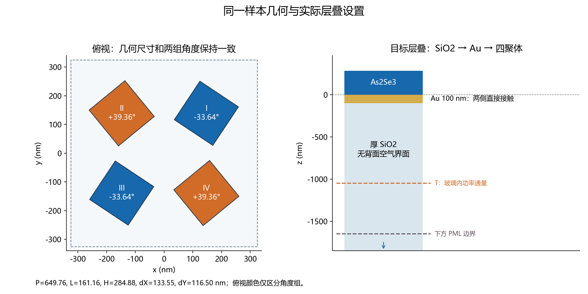
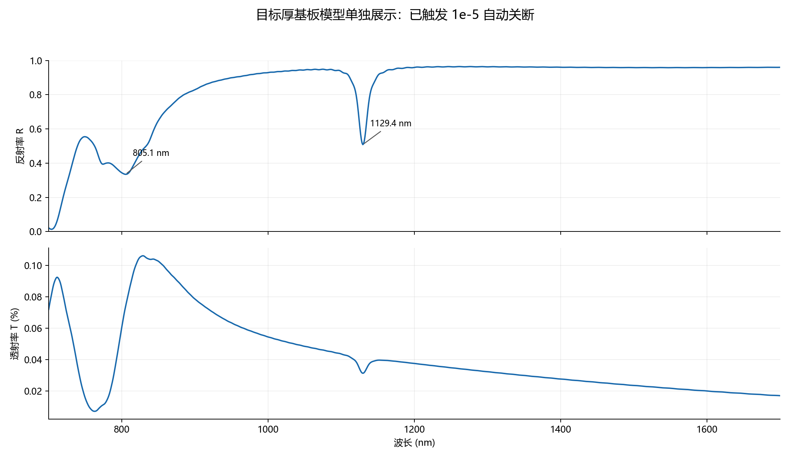
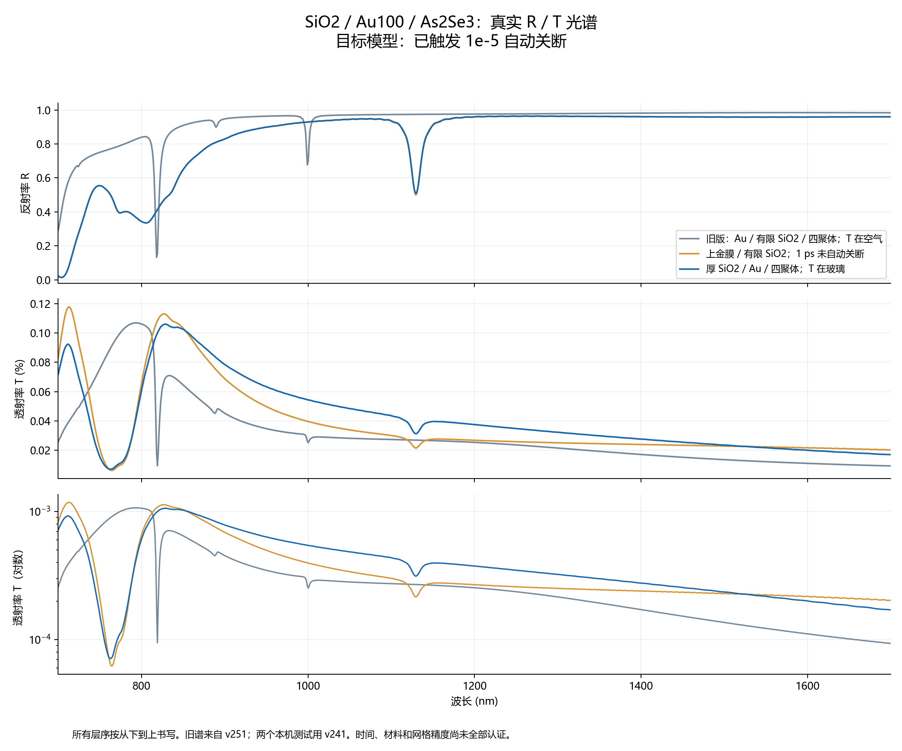
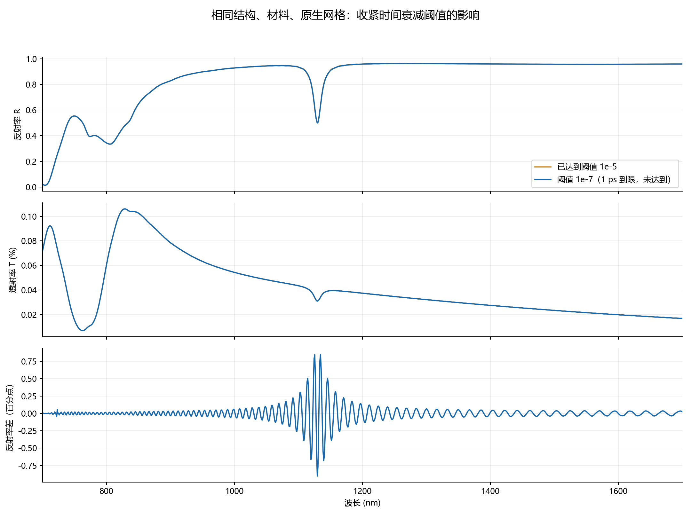

# 厚 SiO2 / Au100 / As2Se3 四聚体：本机测试报告

日期：2026-10-18。所有层序均按 **从下到上** 书写。

## 结论

已按要求实现 **厚 SiO2 → Au 100 nm → As2Se3 四聚体**。层间直接接触，SiO2 延伸穿过下方 PML，去掉基板背面的空气界面；上方保留空气入射区。透射面在 SiO2 内，得到穿过金膜后进入玻璃的真实功率透射谱。

本机样本在 `1e-5` 阈值下约 **3.07 分钟**触发自动关断，实际推进 **0.373154 ps**。主要反射谷约 **805 nm** 和 **1129 nm**，玻璃内透射率范围为 **0.00712%–0.10605%**。Au100 下透射依然弱；去掉基板背面空气不等于获得高透射率。

新版生成器已独立发布到 [Deta_Generator2.0](https://github.com/CypherZzzyer05/Deta_Generator2.0)，包版本 **2.1.0**。原 [Deta_Generator](https://github.com/CypherZzzyer05/Deta_Generator) 保持不变。此次只测试同一个结构，不能把该耗时直接推广到整个随机数据集。

## 1. 实际结构与网格



| 参数 | 数值 |
| --- | --- |
| P / L / H | 649.760 / 161.157 / 284.884 nm |
| dX / dY（未旋转时的名义边缘间隙） | 133.547 / 116.499 nm |
| I、III 象限角度 | −33.6448° |
| II、IV 象限角度 | +39.3634° |
| 四聚体 | z = 0 至 H，As2Se3 |
| Au | z = −100 至 0 nm |
| SiO2 | 顶面 −100 nm，对象向下延伸至 −2850 nm |
| 下方计算域 / PML 边界 | −1650 nm，边界介质为 SiO2 |
| T 监视器 | −1050 nm，位于均匀 SiO2 内 |
| 入射源 / R 监视器 | 884.884 / 1184.884 nm，空气侧，沿 −z 入射 |
| 边界 | x/y 周期，z 上下 PML |
| 光谱采样 | 700–1700 nm，1000 点，间隔约 1.001 nm |
| 金属网格 | 仅金层附近 z 向 8 nm；实际最大约 7.733 nm |
| 原生返回坐标点数 | 84 × 84 × 132；引擎含边界/交错节点的尺寸为 85 × 85 × 155 |
| 最大自动 z 步长 | 约 38.710 nm，未施加全域 10 nm 限制 |
| 原生建议内存 | 约 0.990 GiB |
| 本机资源 | 1 个进程 × 8 线程；Lumerical v241，原生版本 8.31.3633 |

`substrate_depth_nm=350` 在厚基板模式下只是计算域深度参考，**不是 350 nm 的实际玻璃厚度**。图中箭头表示玻璃继续穿过边界，不代表新建了背面界面。原生对象位置与网格由求解器读回核对，见 [preflight](provenance/pml_preflight.json)。

## 2. 反射与透射光谱



| 反射谷波长 nm | 谷底反射率 R | 半突出度宽度 nm |
| --- | --- | --- |
| 805.105 | 0.334550 | 55.431 |
| 1129.429 | 0.508302 | 14.314 |

宽度用 SciPy 半突出度算法描述谱形，**不是已拟合的模式 FWHM**。采样点之外没有进行超分辨率插值。波段左边界附近的低反射背景也不能直接称为一个完整共振谷。

T 是按入射源功率归一化的平面积分 Poynting 通量。由于光沿 −z 传播，对原生 T 面返回值取负；R 面的上行功率取正。这是功率透射率，不是场振幅平方的简单替代，也不是额外乘一个折射率的人工修正。[Ansys 的功率透射定义](https://optics.ansys.com/hc/en-us/articles/360034405354-transmission-Script-command)

## 3. 与旧层叠、有限厚基板的比较



| 算例 | 从下到上的层序 | 透射介质 | 说明 |
| --- | --- | --- | --- |
| 旧版历史样本 | Au / 350 nm SiO2 / 四聚体 | 空气 | 服务器 v251，原生 8.33.3999 |
| 上金膜有限基板 | 350 nm SiO2 / Au / 四聚体 | 空气 | 本机 v241，1 ps 截止，状态 1，未自动关断 |
| 本次目标 | 厚 SiO2 / Au / 四聚体 | SiO2 | 本机 v241，状态 2，达到当前关断阈值 |

旧谱主要反射谷位于 818.118 nm（R=0.1323）和 999.299 nm（R=0.6773），目标谱主要特征变为约 805 nm 和 1129 nm，且第一谷明显变宽。目标谱与旧谱全波段最大绝对 R 差约 **50.83 个百分点**。这组结果提示金膜移至四聚体下方对谱形影响明显；仅凭谷的位置不能把新旧特征认定为同一模式。

有限基板与厚基板的本机预览，最大绝对 R 差约 **0.896 个百分点**，平均约 **0.058 个百分点**。但有限组尚未自动关断，两组 T 的观测介质也不同，不能据此认证完全等效。材料拟合曲线核对与历史样本基本一致，但服务器与本机求解器版本不同；旧谱比较属于预览。

补充同为 1 ps 到限的本机对照：厚基板严格组与有限基板诊断的最大 R 差为 0.2513 个百分点，平均为 0.0075 个百分点。该对照进一步说明本样本反射谱对背面边界的敏感性较小；两组仍为时间到限结果，透射观测介质也不同。

有限组首轮 4 ps 约 34 分钟仍未达到阈值，随后的自动加时已停止；该首轮光谱未成功导出，没有作为本报告数据。报告中的有限组曲线来自后续独立 1 ps 诊断（约 8.48 分钟），带有未自动关断标记。厚基板组约 3 分钟结束，说明本样本的衰减行为有明显改善；不能单凭这一项断定所有慢收敛的原因。

## 4. 更严格的时间衰减检查

相同几何、材料、原生 x/y/z 网格逐点核对一致，只把自动关断阈值从 `1e-5` 收紧到 `1e-7`；时间上限分别为 4 ps 和 1 ps，均保留单次尝试。严格组状态为 **1（时间到限，未达到 1e-7，属于诊断对照）**，耗时 **7.77 分钟**，实际推进 **0.999997 ps**。

全波段最大反射率差为 **0.90273 个百分点**，最大透射率差为 **0.000231 个百分点**。

| 基准谷位 nm | 严格组谷位 nm | 位移 nm | 谷底 R 变化（百分点） | 半突出度宽度变化 |
| --- | --- | --- | --- | --- |
| 805.105 | 805.105 | +0.000 | +0.0158 | -0.007% |
| 1129.429 | 1129.429 | +0.000 | -0.9027 | -2.373% |



按此前采用的“谷位≤2 nm、R 变化≤3 个百分点、宽度相对变化≤10%”标准，这一次时间终止敏感性比较均在范围内。这里的宽度是半突出度宽度；该结果不能替代真正模式线宽、网格、PML 和材料拟合的收敛检查。严格组仍未达到更低阈值，不声称已经完成全面收敛认证。

## 5. Q 值的适用范围

透射谱可用于共振线宽分析，但需要背景处理、足够分辨率及合适的线型。对孤立、近似 Lorentz 线型，用频率定义 `Q = f0 / Δf_FWHM`；窄线宽情况下可近似写为 `λ0 / Δλ`。Fano 线型、重叠峰、宽背景或截断信号需要更合适的模型，不能直接拿任意谷宽作模式 Q。高 Q 模式若在合理 FDTD 时长内不衰减，可考虑时间监视器的衰减拟合。[Ansys 的 Q 值方法](https://optics.ansys.com/hc/en-us/articles/360041611774-Quality-factor-calculations-for-a-resonant-cavity)

**本次没有通过筛选的可靠 Q 候选值，因此不发布一个看似精确的 Q 数字。** 当前谱上存在宽背景、边界附近峰和不对称特征；部分窄特征的时间分辨率也不足。具体拒绝原因保留在 `analysis.json`。

筛选脚本在频率轴上拟合“Lorentz 项 + 线性背景”，要求 R²≥0.98、线宽至少跨 8 个采样间隔、拟合峰与窗口边缘充分分离、频率线宽至少为实际推进时长倒数的 3 倍。后一个条件是本报告采用的保守筛选规则，并非 Ansys 的认证阈值。正式评估高 Q 前，应在目标共振附近加密采样并验证时间、网格、材料及 PML 的影响。

## 6. 验证边界

已完成原生结构核对、金层网格核对、真实求解、R/T 导出和软件流程检查。2.1.0 代码通过 83 项单元测试；GitHub Windows / Ubuntu、Python 3.10 / 3.12 四组 CI 已通过。CI 使用测试替身检验流程，不代表服务器上已经运行了十台真实求解器。本机实测为单个原生 FDTD 引擎。

As2Se3 Joseph 700 nm 薄膜数据只到 1688 nm，1688–1700 nm 保留显式常数端点延拓。Au Palik 宽带拟合的最大 n、k 误差约 0.656、0.903，尚未做材料精度认证；数据级别保持 `pipeline_validation`。本次没有记录空间场增强，也没有重新完成新层叠的 4 nm / 8 nm 网格对照，因此不对这两项作结论。

## 7. 服务器更新与 PyCharm

原项目保留；新版分发名为 `deta-generator2`，模块为 `deta_generator2`，可以和旧包共存。

```powershell
conda activate fdtd_gen
python -m pip install --no-index --no-deps .\artifacts\deta_generator2-2.1.0-py3-none-any.whl
python -m deta_generator2 --version
```

版本应为 `2.1.0`。这条离线安装要求现有环境已有 numpy、psutil；生成数据不需要 CUDA。到新版项目根目录运行，不能在旧版解压目录寻找新版 wheel。

PyCharm 使用 Python 模块 `deta_generator2`，工作目录设为新版项目根目录。参数：

```text
parallel --job-dir jobs/pml_topmetal_au100_metal8_1000_p10 --samples 1000 --jobs 10
```

环境变量：

```text
LUMERICAL_LUMAPI_PATH=E:\Lumerical\ANSYS Inc\v251\Lumerical\api\python\lumapi.py;PYTHONUNBUFFERED=1
```

复制配置并在参数末尾加 `--parallel-action status` 可监视运行。新版共享 `.run` 配置已同步到上述新目录。`--jobs 10` 表示 10 个不同结构并发，线程数省略后按 CPU 预算分配。服务器先做一个新结构的试运行，确认新版 job 包含 `substrate_termination=pml`；旧有限基板任务与旧数据不能混入。

服务器网页若仍打不开，可在可联网电脑下载 [源码 ZIP](https://codeload.github.com/CypherZzzyer05/Deta_Generator2.0/zip/refs/heads/main)，或复制本机已准备的离线 ZIP。仓库已确认公开可用，服务器自身网络问题尚未远程诊断。

## 8. 数据与复现

- [CSV 光谱](data/spectra.csv)：直接查看三组 R/T，T 列为 0–1 功率比例，画百分比时乘 100。
- [时间检查 CSV](data/time_check.csv)：包含严格 1 ps 诊断的 R/T，未达到更低阈值的标记见机器可读分析。
- [机器可读分析](analysis.json)：几何、峰谷、宽度、时间对照、Q 筛选及数据文件 SHA256。
- [厚基板样本](data/pml_topmetal_sample0.npz)、[有限基板诊断](data/finite_topmetal_diagnostic.npz)、[旧样本](data/historical_sample0.npz)。
- [严格 1 ps 诊断样本](data/pml_topmetal_strict.npz)：状态 1，不能当作严格阈值合格的训练样本。
- `provenance/` 保存设置、原生预检查、材料拟合身份和去除运行身份/许可上下文的求解日志；原始日志与大型 FSP 文件保留在本机，不纳入 GitHub。
- 原始 100 样本数据集 SHA256：`591ca0f4d9f4fc0be9803f3a566f72eee1ee3ac871ad9d03472b93a732aed0e3`。

绘图与分析脚本位于仓库 `scripts/`，只读取真实结果，不生成替代光谱。层叠生成脚本在生成器仓库 `scripts/local_stack_test.py`；厚基板默认 `--substrate-termination pml`，有限对照必须显式选择 `finite`。绘图所需可选依赖见根目录 `requirements-analysis.txt`。

结构穿过 PML 的设置参照 [Ansys PML 建模说明](https://optics.ansys.com/hc/en-us/articles/360034382414-Always-extend-structures-through-PML-boundary-conditions)。所有后续正式设计结论仍需针对新的层叠单独验证。
