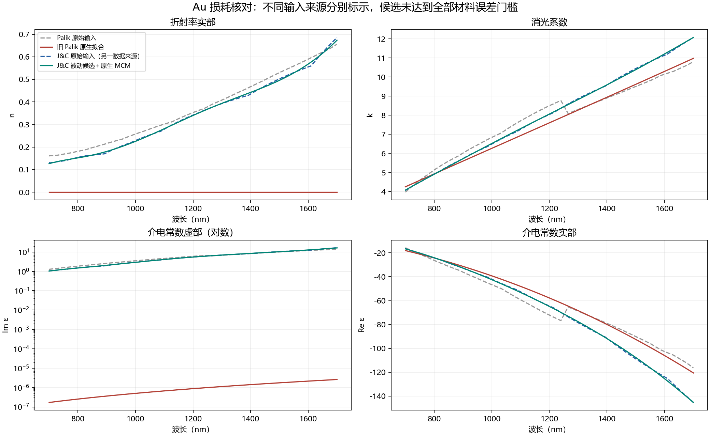
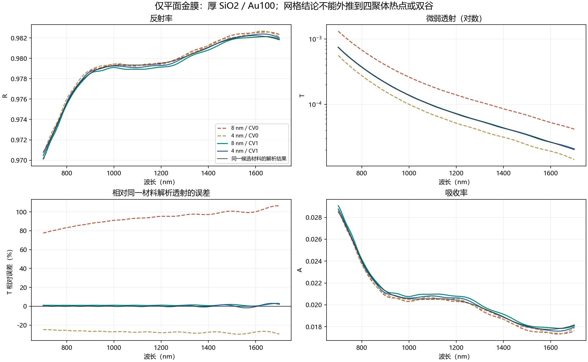

# Au 损耗修正候选与平面金膜网格核对

2026-10-21；Lumerical 8.31.3633；独立工作树 `codex/v2-metal-loss-fix`。

[研究代码与全部失败尝试（固定提交 9af3e19）](https://github.com/CypherZzzyer05/Deta_Generator2.0/tree/9af3e19)。文末复现命令需在该研究代码仓库执行，Report 仓库只保存报告和结果。

已建立恢复金损耗的研究候选，并完成平面 Au100 nm / 厚 SiO₂ 的原生 FDTD 与解析薄膜对照。**候选尚未达到全部材料误差门槛，生产生成器和服务器默认配置未修改，也未发布 2.2.0。** 原始 1000 样本与模型权重保留。

## 已确认的问题

旧 Palik 输入的 Im ε 为 1.277–14.173，原生默认拟合却只有 1.69e-7–2.60e-6。平面金膜验证中，旧模型的 R 与同一 Palik 原始输入的解析结果最大相差 **3.816 个百分点**，金属吸收几乎消失。仅仅自动关断到状态 2 不能证明材料正确。

将容差改为零、提高系数或调整虚部权重并没有得到合格 Palik 拟合；关闭被动性/稳定性限制的诊断也未解决问题。相关失败结果均保留。原生 MEL 插件嵌套虽然能保存参数，实际计算未复现完整模型，也已排除，没有用于候选结果。

直接读取数据库原始采样表还发现：Palik 输入在 1240 nm 的 k=8.77，而在 1265 nm 的 k=8.09。该急变来自输入表，不是图表重采样造成；原始查询保存于 `input_samples.json`。这提示应单独审核数据来源，不能只增加拟合阶数；这里不据此判定哪一组数据就是实际沉积薄膜的真值。

## 候选来源和保留的误差

研究候选使用数据库 **Au (Gold) - Johnson and Christy**，与旧 Palik 是不同输入来源，不能把两者差异全部归因于拟合修正。Johnson/Christy 的原始工作通过薄膜反射和透射测量获得金等贵金属光学常数，覆盖本次波段。[原始论文](https://doi.org/10.1103/PhysRevB.6.4370)

先拟合正强度、正阻尼的 Drude＋三个 Lorentz 极点，再导入 Sampled 3D data，由原生 MCM 表示；未用恒定 n/k、PEC 或增益模型替代金。原生 MCM 相对这一解析候选的最大 n/k 差约为 2.1e-7 / 3.1e-7。拟合参数、数据来源和实际原生结果均归档。[原生材料定义与限制](https://optics.ansys.com/hc/en-us/articles/360034394634-Standard-optical-permittivity-material-models-in-FDTD-and-MODE) · [getfdtdindex 的含义](https://optics.ansys.com/hc/en-us/articles/360034409694-getfdtdindex-Script-command)

| 相对 J&C 原始输入的最大误差 | 候选 | 预先采用的研究门槛 |
| --- | ---: | ---: |
| n 绝对误差 | 0.01683 | 0.02，通过 |
| k 绝对误差 | 0.09196 | 0.05，**未通过** |
| Re ε 相对误差 | 1.637% | 2%，通过 |
| Im ε 相对误差 | 4.428% | 5%，通过 |

700–1700 nm 内候选 Im ε 全为正。**上述材料门槛不是用户此前的谷位/深度门槛；未放宽门槛来宣称合格。** 图中 Palik 和 J&C 分别标示。



## 平面薄膜验证

层序：从下到上为延伸穿过下 PML 的 SiO₂、100 nm Au、入射空气；没有玻璃背面的空气界面。这里没有四聚体。横向均匀场使用周期边界，横向网格 20 nm；空气与玻璃 z 向参考网格上限 20 nm，仅金膜 z 向改变为 1/2/4/8 nm。该平面参考网格不等于生产四聚体的自动网格。

功率监视器和光源均在 PML 之外，实际坐标检查已通过。解析计算同时保存“原始输入 n/k”与“原生实际拟合 n/k”两组，区分材料近似和数值误差。解析函数通过零厚度 Fresnel 极限与无损膜能量守恒检查；所有下列原生计算都达到状态 2。未裁剪 R/T/A。

| 金属界面处理 | 金属请求网格 nm | R 相对同一候选解析结果的最大误差，百分点 | T 最大绝对误差 | 状态 |
| --- | ---: | ---: | ---: | ---: |
| CV0 | 1 | 0.04655 | 0.00005391 | 2 |
| CV0 | 2 | 0.04582 | 0.00010099 | 2 |
| CV0 | 4 | 0.05116 | 0.00018357 | 2 |
| CV0 | 8 | 0.06916 | 0.00057812 | 2 |
| CV1 | 2 | 0.04113 | 0.00000168 | 2 |
| CV1 | 4 | 0.02769 | 0.00000172 | 2 |
| CV1 | 8 | 0.05859 | 0.00000825 | 2 |

CV0 是当前默认方式，金属界面不使用共形处理；CV1 将共形处理用于金属界面。官方说明 CV1 是否更准确取决于具体网格及材料，不能据平膜结果直接切换所有器件。[官方网格说明](https://optics.ansys.com/hc/en-us/articles/360034382614-Selecting-the-best-mesh-refinement-option-in-the-FDTD-simulation-object)

| 同一候选 8 nm 与 4 nm 的差异 | CV0 | CV1 |
| --- | ---: | ---: |
| 最大 R 绝对差，百分点 | 0.07448 | 0.03223 |
| 最大 T 绝对差 | 0.00076170 | 0.00000733 |
| 最大 T 相对差，以 4 nm 为分母 | 192.71% | 2.37% |

这里透射很弱，因此“R 看起来一样”不能替代 T 收敛检查。CV1 明显改善本平膜的透射数值误差，但尚未核对四聚体的双谷位置、线宽、热点或场增强。

候选 CV1/8 nm 相对 J&C 原始输入解析薄膜的最大 R 差为 **0.09722 个百分点**，最大 T 绝对差为 **0.00001639**。这些小误差只支持本平膜案例，不等于完整器件已验证。



## 下一步和复现

继续处理全波段 k 拟合残差，并在真实厚 SiO₂ / Au100 / As₂Se₃ 四聚体上进行材料与网格对照后，再决定 2.0 的生产更新。原有 1000 样本仍仅用于已披露的数值流程训练，不能与新的材料或层序数据混合。

本目录 `summary.json` 保存定量结果及原始结果校验值；`film_benchmark_clear_pml/` 保存实际 NPZ、原生参数 JSON；较早紧凑空间的 pilot 与不合格材料结果保留为诊断，不列为通过证据。原生 FSP 和进度日志保留在 D 盘，未加入 Git。

在安装了 numpy、psutil、scipy、matplotlib 和 Lumerical API 的研究环境下，从仓库根目录执行：

```powershell
python scripts/benchmark_gold_film.py --case smooth_jc --mesh-nm 8 --mesh-variant 1 --run
python scripts/summarize_gold_film.py
```

已有结果目录禁止重复求解覆盖；脚本只用于独立薄膜研究，不启动服务器数据任务。
