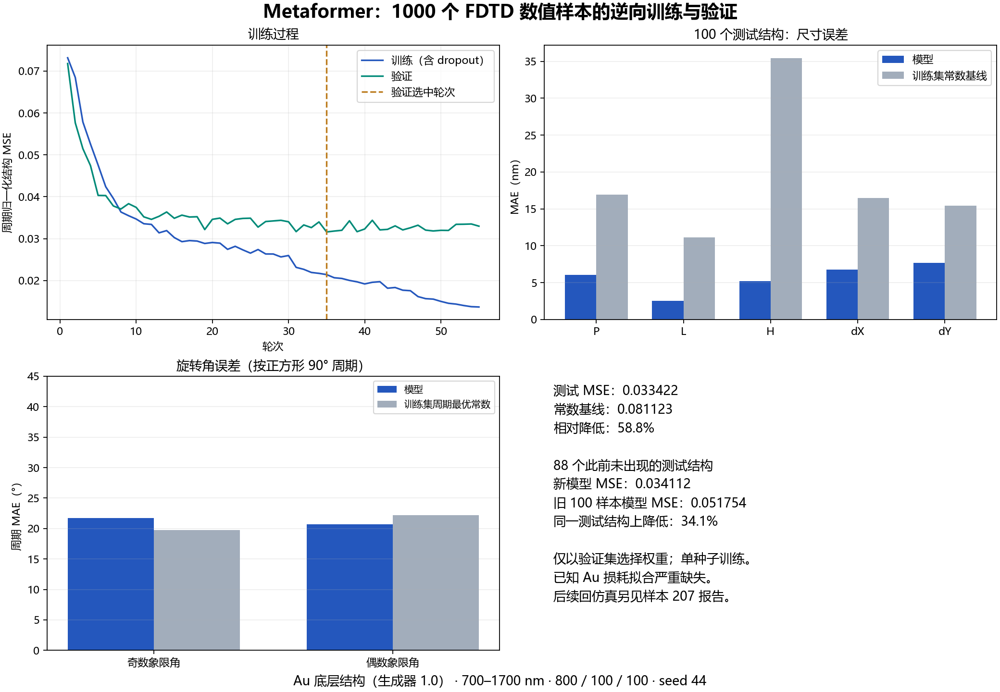
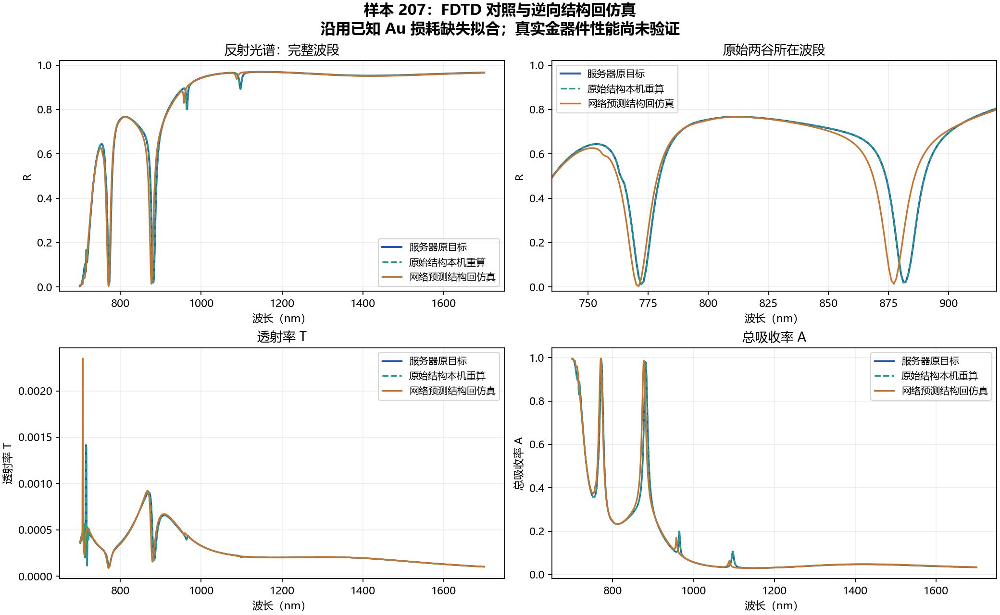

# 样本 207：逆向 Metaformer 的真实 FDTD 回仿真

**材料限制：这批服务器数据和本次回仿真均沿用了已知严重缺失 Au 欧姆损耗的拟合。** 原始输入 Palik 损耗的审核见 [2026-10-18 材料更正](https://github.com/CypherZzzyer05/Report/blob/main/reports/2026-10-18_device_feasibility/README.md)。本次进一步确认，1000 样本数据存档的 Au 拟合 Im(ε) 也只有 **1.69e-7–2.60e-6**，与本机这套问题拟合一致。因此这里验证的是训练数据所用数值体系的闭环；真实 Au 器件性能必须在材料修正后重新验证。仅写“材料拟合未认证”不足以表达这项已知问题。

**网络预测结构保留了两个明显深谷，但尚未达到此前参考门槛下的精确目标匹配。** 第一谷偏移约 1.0 nm，第二谷偏移约 4.0 nm；两谷深度和半突出度宽度变化均在参考范围内，第二谷位移超过 2 nm。

这是冻结的 1000 样本逆向模型对一个此前未出现的测试结构的验证。目标光谱、结构预测和验证对象在求解前已存档，未根据回仿真结果重新挑选目标或修改网络输出。

## 1000 样本训练与独立测试

40 个分片的全部 1000 条原始样本均已核对，原始数据未修改。按 800/100/100 划分，使用无 ResNet 的七参数逆向 Metaformer（3,998,087 参数）；训练 55 轮，以验证误差最低的第 35 轮权重评估，训练用时约 141.5 秒。

| 参数 | 100 条测试数据的 MAE |
| --- | ---: |
| P / L / H | 6.05 / 2.50 / 5.16 nm |
| dX / dY | 6.76 / 7.65 nm |
| 奇数 / 偶数象限角 | 21.70° / 20.73° |

测试归一化 MSE 为 **0.033422**，比训练集常数基线降低 **58.8%**。与旧 100 样本模型在同一批 **88 个此前未出现的测试结构**上比较，MSE 降低 **34.1%**。尺寸预测明显改善，但角度部分 MSE 仍比周期常数基线高约 2.1%，不能据此认定角度影响很小。训练标准化仅使用 800 条训练光谱。



[完整训练记录和复现说明](https://github.com/CypherZzzyer05/Optics_design/blob/6686084/Metaformer_As2Se3/results/inverse_au100_1000/report.md) · [模型权重](https://github.com/CypherZzzyer05/Optics_design/blob/6686084/Metaformer_As2Se3/models/inverse_au100_1000.pt)。上述统计与下面的单目标光谱回仿真分别评价结构误差和光谱误差；两者均受已知 Au 拟合问题限制。

## 原始结构对照

数据源使用服务器 Lumerical 8.33.3999，本机为 8.31.3633。先在本机重算产生目标光谱的原始结构，核对材料、几何、网格和光谱，再计算网络预测结构。

本机三种材料的实际拟合 n/k 与服务器存档在 `rtol=atol=1e-7` 下均一致。原始结构重算达到自动关断状态 2，耗时 **573.437 秒**。与服务器目标相比，完整波段反射率最大绝对差为 **9.67e-7**，RMSE 为 **3.25e-7**；两处主谷的复现检查均通过。

因此，下面比较中可观察到的谱线差异来自预测结构，而不是当前这次原始结构复现中的明显版本差异。

## 网络输出与回仿真

| 参数 | 目标对应的原始结构 | 网络直接输出 |
| --- | ---: | ---: |
| P | 689.422 nm | 680.704 nm |
| L | 189.669 nm | 189.964 nm |
| H | 355.181 nm | 354.645 nm |
| dX | 139.927 nm | 139.789 nm |
| dY | 104.666 nm | 96.984 nm |
| 第一/第三象限角 | 2.811° | −22.596° |
| 第二/第四象限角 | 35.770° | 1.208° |

预测结构的求解耗时 **733.922 秒**，一次运行即达到状态 2，初始时间上限保持 4 ps，自动关断阈值保持 `1e-5`。两组均使用 1 进程、8 线程，单组顺序计算；只在金属层附近设置 z 向 8 nm 网格，实际金属区最大步长约 7.733 nm，其他区域为自动网格。

| 指标 | 目标谷1 | 预测谷1 | 目标谷2 | 预测谷2 |
| --- | ---: | ---: | ---: | ---: |
| 中心波长 | 772.072 nm | 771.071 nm | 881.181 nm | 877.177 nm |
| 谷底反射率 R | 0.012016 | 0.003652 | 0.019899 | 0.013589 |
| 半突出度宽度 | 9.675 nm | 10.172 nm | 12.146 nm | 12.609 nm |

| 变化及初步参考标准 | 谷1 | 谷2 |
| --- | ---: | ---: |
| 中心位移，参考 ≤2 nm | 1.001 nm，通过 | 4.004 nm，未通过 |
| 谷底 R 绝对变化，参考 ≤0.03 | 0.008364，通过 | 0.006310，通过 |
| 宽度相对变化，参考 ≤10% | 5.13%，通过 | 3.81%，通过 |

两谷均继续满足 R≤0.2、突出度≥0.4、宽度跨至少 5 个采样间隔，以及分离/谷间抬升条件。预测谱中突出度≥0.10 且达到这一宽度要求的谷仍为两个。该判断不排除更弱或未解析的附加特征。

完整 700–1700 nm 波段的反射率 RMSE 为 **0.04041**；最大绝对误差 **0.35362** 位于约 **875.175 nm**，对应第二谷移动后的陡峭侧翼。这一最大误差仍需保留，不能只报告谷底值接近。



## 结果的含义

这一次验证形成了“未参与训练的目标光谱 → 网络直接输出七参数 → 真实 FDTD 光谱”的链路。它证明当前模型能够为这个目标给出保留双谷形状的近似结构。**第二谷仍偏移 4 nm，当前结果不算满足全部参考标准的精确重建。**

该预测与原始结构的两个角差异较大，但计算光谱仍有相似的主双谷；结构参数误差与光谱误差应分别评价。由于 P、dY 和两个角同时变化，本对照没有单独证明角度影响很小，也没有验证唯一逆映射。

本次只有一个目标的回仿真，不能替代 100 条测试结构的光谱统计。此前的训练/验证/测试结构指标与原始数据保持不变。Au 损耗拟合存在上述已知严重偏差，数据保持 `pipeline_validation`；没有据半突出度宽度宣称真实器件的吸收率、模态 Q 或 BIC。

本次层序从下到上为 **Au 100 nm → 有限厚 SiO2 350 nm → As2Se3 四聚体**，与训练集一致。2.0 的厚 SiO2 / 中间 Au / 四聚体层序需要使用相应数据训练和验证。

## 文件和复现

本目录的 `reference.npz/csv`、`prediction.npz/csv` 是实际求解结果，`*_native.json` 记录实际材料拟合、网格、求解状态和校验值；`analysis.json` 保存逐谷比较。原生 FSP 及进度日志保留在本机 `runs/inverse_roundtrip_207/{reference,prediction}/projects`。

脚本复用独立生成器 1.0 的真实求解器，原生成器及原始数据未修改。在安装了对应 numpy、psutil 和 Lumerical API 的环境下执行：

```powershell
python validate_inverse207.py --generator-source D:/projects/Deta_generator_merge_recovery --case reference
python validate_inverse207.py --generator-source D:/projects/Deta_generator_merge_recovery --case reference --run
python validate_inverse207.py --generator-source D:/projects/Deta_generator_merge_recovery --case prediction --run
python analyze_inverse207.py
```

省略 `--run` 只做原生预检查。已有成功结果不会被重复求解覆盖。所有项目和临时文件写入 D 盘；这次结束后 C 盘约剩 2.70 GB，两个原生求解器进程均已退出。

项目复现脚本和模型位于 [Optics_design，提交 16beb8e](https://github.com/CypherZzzyer05/Optics_design/tree/16beb8e/Metaformer_As2Se3)。上方命令应在该项目目录运行；本 Report 文件夹用于保存报告、图表和对应结果。
