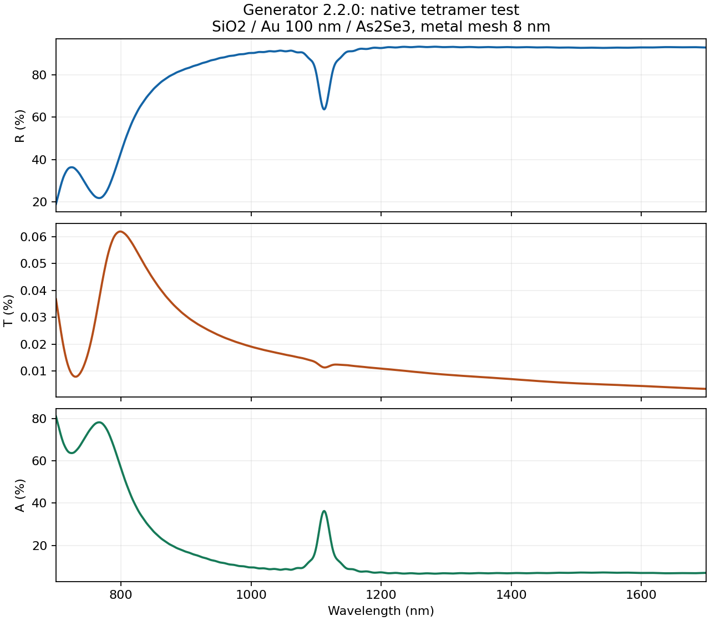

# 数据生成器 2.2.0：Au 损耗修正与运行验证

日期：2026-10-22。发布仓库：[Deta_Generator2.0](https://github.com/CypherZzzyer05/Deta_Generator2.0)。

对应发布提交：[5cd85b4](https://github.com/CypherZzzyer05/Deta_Generator2.0/commit/5cd85b4)。已从 GitHub 实际下载发布 wheel，SHA-256 与本报告一致。

**修正版已通过固定的 Au 材料拟合门槛、平面金膜解析对照，以及一个完整四聚体的原生求解与导出。服务器应安装 2.2.0 并新建任务，保留旧数据。** 当前数据等级仍为 `pipeline_validation`。

## 修复内容

旧默认 Au/Palik 的原生时间域拟合几乎消除了欧姆损耗。新版本明确更换参考来源为 Johnson–Christy，用正强度、正阻尼的 Drude/Lorentz 色散表达式建立 `Au (Gold) - JC passive NIR v1`，再导入 Lumerical 原生拟合。本次发布使用 Drude 项加八个 Lorentz 项；此前报告中的三项候选未通过全部门槛，已由本版本替代。[Johnson–Christy 原始论文](https://doi.org/10.1103/PhysRevB.6.4370)

每次实际求解前读取 `getfdtdindex` 的拟合结果，核对 n、k 与复介电常数损耗；不再仅依据光谱能量闭合或自动关断判定材料正确。材料模型哈希写入任务指纹，旧任务不能改配置后续算混入新结果。[原生拟合查询说明](https://optics.ansys.com/hc/en-us/articles/360034409694-getfdtdindex-Script-command)

层序保持 **厚 SiO2 → Au100 nm → As2Se3 四聚体**。金膜 z 向局部网格为 8 nm，其余自动；Au 默认采用 `conformal variant 1`。扩大源和监视面的边界余量，并读取原生 PML 网格，拒绝 source/R/T 落入 PML 的配置。保留并行共享队列、尾部补位及 Windows 合并写入修复。[金属界面网格说明](https://optics.ansys.com/hc/en-us/articles/360034382614-Selecting-the-best-mesh-refinement-option-in-the-FDTD-simulation-object)

## 材料与平膜验证

本机 Lumerical v241，原生版本 `8.31.3633`；波段 700–1700 nm，1000 个采样点。

| 原生 Au 拟合指标 | 实测最大值 | 固定门槛 |
| --- | ---: | ---: |
| n 绝对误差 | 0.019685 | 0.020000 |
| k 绝对误差 | 0.049854 | 0.050000 |
| Re(ε) 相对误差 | 1.184% | 2% |
| Im(ε) 相对误差 | 3.865% | 5% |

原始 JC 数据的 Im(ε) 范围为 1.06377–16.55158，原生拟合为 1.02678–16.96691；源波段无增益。额外扩展频率采样 10¹⁰–10¹⁸ Hz 中最小 Im(ε) 为 1.77×10⁻⁵。旧 Au/Palik 配置实际运行 `doctor` 被拒绝，退出码为 1，未进行时间推进。

平面 Au100 nm/玻璃模型用传输矩阵法（TMM）独立核对。表中为整个波段的最大绝对误差，R/T 均以 0–1 功率比例表示。

| 金属请求网格 | 对照参考 | 最大 R 误差 | 最大 T 误差 |
| --- | --- | ---: | ---: |
| 8 nm | 同一原生材料模型的 TMM | 0.000541 | 0.00000852 |
| 4 nm | 同一原生材料模型的 TMM | 0.000323 | 0.00000147 |
| 8 nm | 原始 JC 数据的 TMM | 0.000964 | 0.00002335 |
| 4 nm | 原始 JC 数据的 TMM | 0.000915 | 0.00001953 |

两组均原生 status=2。该平膜检查利用平移不变性采用粗横向网格，不能据此认证完整四聚体的 8/4 nm 网格收敛。

## 一个完整四聚体的真实求解

采用新任务的首个种子样本，P/L/H/dX/dY 为 649.760/161.157/284.884/133.547/116.499 nm，奇/偶象限角为 −33.645°/+39.363°。此样本用于验证修复后的生成流程，并非逆向网络生成的最优结构。

- 原生求解一次完成，status=2；求解及提取耗时 **129.516 秒**，成功保存 CSV、NPZ 及数据集。
- 配置最长时间 4 ps，实际在 0.2440424 ps 自动关断，最终 Auto Shutoff=9.70468×10⁻⁶。
- 金膜实际最大 z 网格 7.73333 nm；x/y 步长 7.82844 nm。自动网格区 z 最大 38.46154 nm，并非全域 8 nm。
- source、R、T 均经原生 PML 检查，位于有效内部区域；T 在玻璃中，玻璃穿过下方 PML。
- R 为 0.188905–0.934216，T 为 0.00003433–0.00061904，A 为 0.065688–0.810727。图中百分比显示；T 最大约 **0.0619%**。



## 程序与发布验证

106 项测试全部通过（90.433 秒），覆盖材料门槛拒绝、旧 Au 损耗丢失拒绝、PML 越界拒绝、并行任务补位及 Windows 写入流程等。程序测试使用模拟求解器；上述平膜与完整四聚体是单独运行的真实原生求解。

wheel 已在独立安装目录导入并初始化验证，其 22 个包文件与最终源文件逐字节一致；完整四聚体记录的四个实现文件哈希也与发布实现一致。

| 文件 | SHA-256 |
| --- | --- |
| `deta_generator2-2.2.0-py3-none-any.whl` | `35cb97812dd8ab55f2718827f32c4a688cdf2d9d6aa24df32478011404f9adfe` |
| `au_jc_passive_nir_v1.json` | `3d99086d70e1ecfcd0475f616029318a6549961856ca3c571c74376d298171a5` |

本目录附 [验证汇总](validation_summary.json)、[材料检查](gold_material_validation.json)、[完整四聚体预检查](tetramer_preflight.json)、[原生求解日志](tetramer_solver_log.txt)、[CSV](tetramer_sample_000000.csv)、[NPZ](tetramer_sample_000000.npz)，以及 [8 nm](film_8nm_validation.json)/[4 nm](film_4nm_validation.json) 平膜记录。

## 服务器更新与重启

确认旧任务及其原生求解器已停止后，在 PyCharm 使用的 conda 环境执行：

```powershell
python -m pip install --upgrade --no-deps https://raw.githubusercontent.com/CypherZzzyer05/Deta_Generator2.0/main/artifacts/deta_generator2-2.2.0-py3-none-any.whl
python -m deta_generator2 --version
```

版本必须输出 `2.2.0`。PyCharm 模块设为 `deta_generator2`，关闭“添加内容根/添加源根”，参数改为：

```text
parallel --job-dir jobs/jc220_topmetal_au100_metal8_1000_p10 --samples 1000 --jobs 10
```

环境变量保留：

```text
LUMERICAL_LUMAPI_PATH=E:\Lumerical\ANSYS Inc\v251\Lumerical\api\python\lumapi.py;PYTHONUNBUFFERED=1
```

监控配置使用同一命令，末尾添加 `--parallel-action status`。启动器先在服务器 v251 上执行原生预检查，通过后才派发计算。本机 v241 的结果不能替代该服务器检查；若服务器拒绝材料拟合，应保留预检查日志，不放宽门槛继续计算。

旧数据、原始文件、训练结果与权重保留。新材料的实验薄膜精度、完整器件的场强/模态 Q/BIC 归因尚未认证；As2Se3 在 1688–1700 nm 的 12 nm 端点延拓仍显式记录。Ag 的布局/PML 预检查已通过，本次未完成 Ag 材料新模型与完整器件验证。
