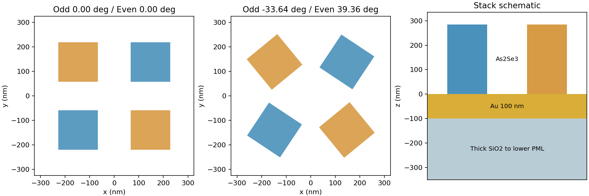
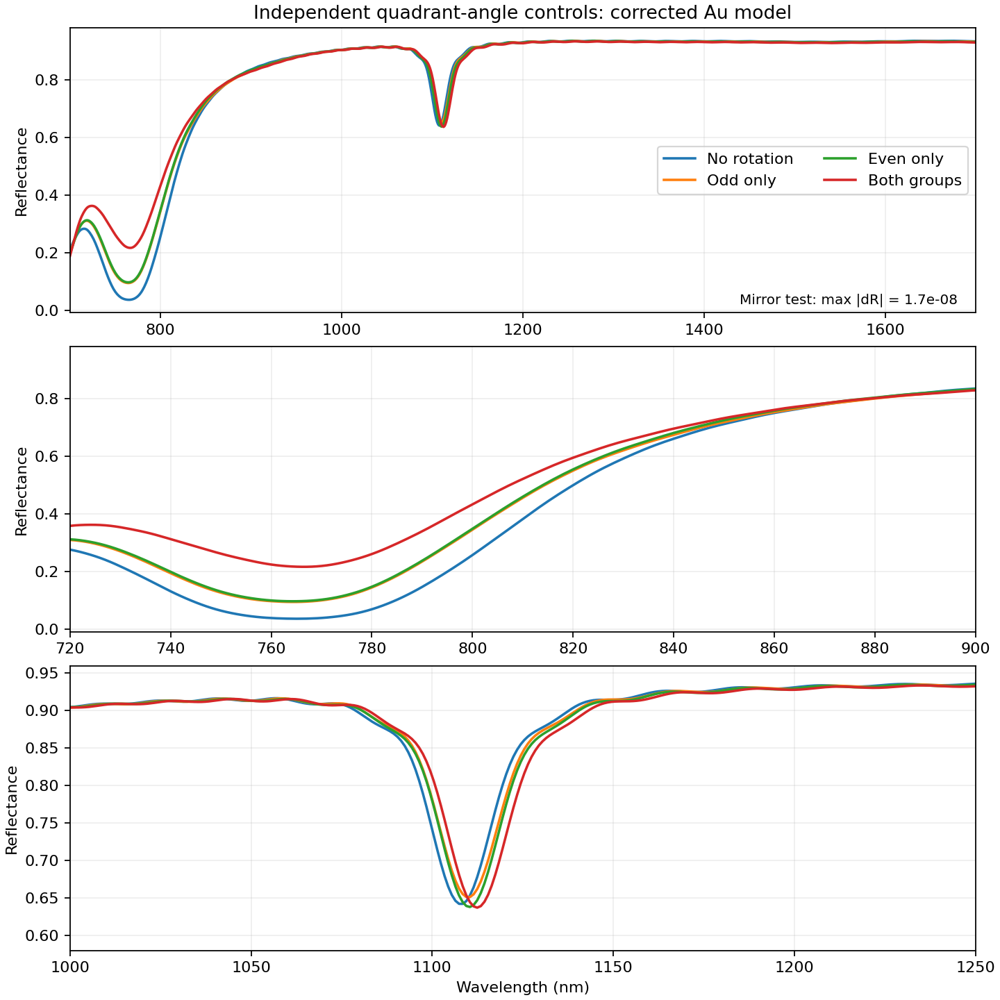
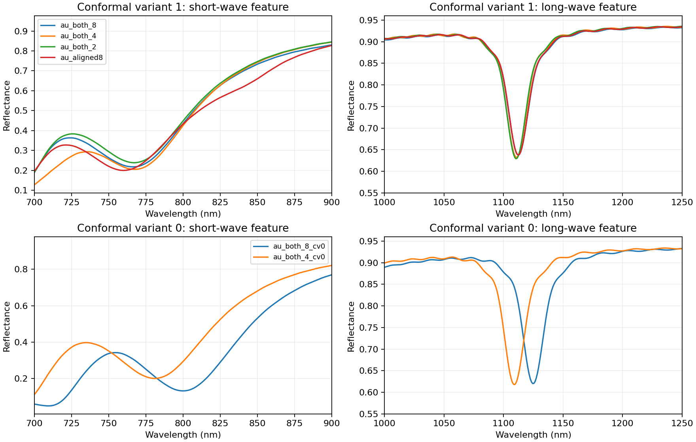
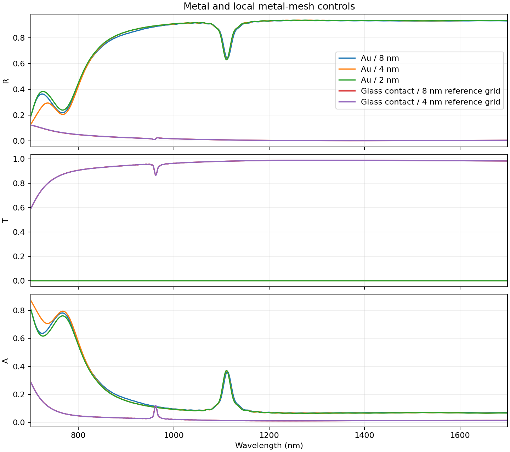
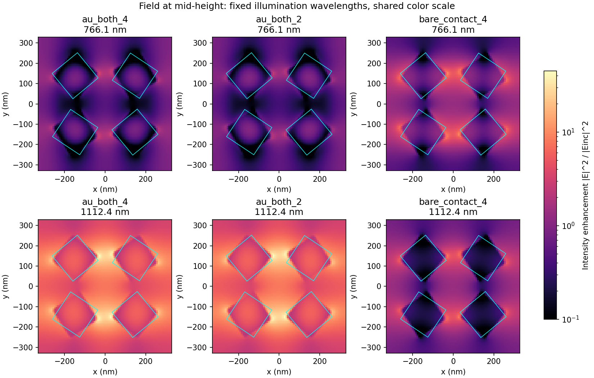

# 修正 Au 后的角度、金层与网格对照

日期：2026-10-22。代码：[研究分支](https://github.com/CypherZzzyer05/Deta_Generator2.0/tree/codex/rotation-jc220-study)，提交 `5d2a081`。本报告采用生成器 2.2.0 的被动 JC 金模型。

**金材料拟合修正通过，但完整器件的金属局部网格尚未通过既定门槛，应继续暂停大批量生产。角度扫描显示双谷深度变化，镜像对照验证了同谱等价关系；材料检查与网格收敛分别判断。**

## 对照结构与实际计算

P/L/H/dX/dY 固定为 649.760/161.157/284.884/133.547/116.499 nm，奇/偶象限角分别控制 I/III 和 II/IV。原生版本 `8.31.3633`，法向 x 线偏振入射，700–1700 nm 均匀 1000 点；每次求解前核对原生材料拟合。

从下到上为厚 SiO2 / Au100 nm / As2Se3 四聚体。去金对照把原金膜区域替换为玻璃，柱体仍从 z=0 开始并直接接触玻璃；基板穿过下方 PML。该对照不同于保留 100 nm 空隙后仅删除金膜。4 nm 金/去金对照的实际网格一致性为 `{"x": true, "y": true, "z": true}`。

共 12 次真实四聚体求解，全部 status=2，原生求解累计耗时 37.4 分钟；均使用真实 FDTD，无替代光谱。金属局部 8/4/2 nm 指金属附近 z 向上限，x/y 自动网格约 7.83 nm，其他区域的 z 网格可大于 10 nm。去金对照保留对应参考网格用于数值控制。



## 独立角度的影响

此部分四组采用金属局部 8 nm，适合观察对照趋势，数值定型仍须细网格复核。反射谷以局部显著度至少 0.02 检出；宽度定义为**半显著度宽度**，并非由此直接取得模态 Q。

| 组合 | 奇/偶角度 ° | 谷1 nm | 谷底R1 | 宽度1 nm | 谷2 nm | 谷底R2 | 宽度2 nm |
| --- | ---: | ---: | ---: | ---: | ---: | ---: | ---: |
| 全不旋转 | 0.00 / 0.00 | 765.07 | 3.71% | 54.45 | 1108.41 | 64.23% | 20.14 |
| 仅奇数象限旋转 | -33.64 / 0.00 | 764.06 | 9.54% | 47.87 | 1110.41 | 65.15% | 20.38 |
| 仅偶数象限旋转 | 0.00 / 39.36 | 764.06 | 9.78% | 47.43 | 1110.41 | 63.82% | 20.38 |
| 两组都旋转 | -33.64 / 39.36 | 766.07 | 21.73% | 39.40 | 1112.41 | 63.73% | 20.54 |

在这一个尺寸组合中，旋转主要显著改变第一个谷的深度与宽度，两个谷的位置变化较小。两组角度的联合影响不是单次旋转的线性叠加：`R11 − R10 − R01 + R00` 的全波段最大绝对值为 7.06 个百分点，均方根为 1.35 个百分点。它是该四组端点的交互量，不是适用于全部尺寸、角度的拟合规律。



## 镜像同谱：逆向角度不具有全局唯一性

在本次法向、x 线偏振和各向同性材料条件下，沿 x 镜像会把角度映射为：

`(θ奇, θ偶) → (−θ偶, −θ奇)`。

因此 `(−33.6448°,39.3634°)` 与 `(−39.3634°,33.6448°)` 是互为镜像的两种参数。实际顶点最大镜像误差为 0 nm；两次原生求解的整条 R 谱最大差为 **1.71e-08**。纯标量 R/T/A 在该测量条件下无法唯一分辨这对结构。

这为逆向模型提供了明确的预处理方向：训练时可统一选择 `θ奇+θ偶≥0` 的镜像代表；评估时对允许的镜像等价结构取最小角度误差，并用回仿真的光谱误差验证设计。它减少了一类一谱多解，不保证排除所有其他非唯一解。本轮只给出物理依据与原生验证，未修改训练架构、未进行新的网络训练。

## 网格结论：8 nm 不能直接用于定量结论

采用已确认标准：谷位差≤2 nm、全波段最大绝对 R 差≤0.03、宽度相对差≤10%、平面平均与95分位强度增强相对差≤10%。下表均以**更细网格**为分母；字段中的 pp 表示反射率百分点。场统计覆盖两张 XY 平面及 23 个实际监视波长。

| 粗/细对照 | 最大R差 | 最大谷位差 nm | 最大宽度差 | 最大场均值差 | 最大场95分位差 | 结论 |
| --- | ---: | ---: | ---: | ---: | ---: | --- |
| 有金 CV1，8/4 nm | 12.182 pp | 2.002 | 35.3% | 16.2% | 18.5% | 未通过 |
| 有金 CV1，4/2 nm | 13.298 pp | 0.000 | 22.8% | 15.6% | 28.3% | 未通过 |
| 有金 CV1，对齐7.69/2 nm | 9.190 pp | 7.007 | 2.7% | 33.8% | 40.2% | 未通过 |
| 有金 CV0，8/4 nm | 24.929 pp | 19.019 | 1.5% | 109.3% | 127.2% | 未通过 |
| 去金，8/4 nm | 0.098 pp | 不适用/未匹配 | 不适用/未匹配 | 1.7% | 3.4% | 通过 |

若去金两组均无显著反射谷，其谷位/宽度门槛不适用，仍检查 R 和场统计。约 1.001 nm 的原始谱采样使接近 2 nm 的谷位差存在采样限制；不能据此掩盖明显超限的宽度或幅度误差。**4/2 nm 本轮仍未通过全部门槛，4 nm 也不能直接认定收敛；应继续做更细网格及误差来源核对，暂缓用于器件结论的大批量生产。**

平面金膜此前通过独立 TMM 检查，但本轮完整器件 8/4 nm 不通过，证明前者不能替代器件检查。这里也没有认证 x/y 或全域三维网格的收敛。

额外做了界面对齐控制：请求金属网格 `100/13≈7.6923 nm`，实际网格节点落在金膜上下边界，但仍需以表中的对照决定其是否通过。对齐本身不能作为收敛证据。

Conformal variant 0 的 8/4 nm 也未通过本轮全部门槛，不能仅切换算法便宣称问题解决。 该对照保留相同尺寸、材料、入射与记录波长，只调整金属界面的离散算法。Ansys 官方说明 variant 1 在部分金属粗网格情况下可能比默认 variant 0 更差，并建议比较两种算法；若一个单元含三种以上材料，会退回阶梯近似。实际接触区的误差来源尚需进一步分解，本轮不把某一具体机制当成已确认根因。[Ansys 网格方法说明](https://optics.ansys.com/hc/en-us/articles/360034382614-Selecting-the-best-mesh-refinement-option-in-the-FDTD-simulation-object)

补充的 variant 0 平膜检查：8 nm 和4 nm 对同一材料 TMM 的最大 R 误差分别为 0.000656/0.000438，最大 T 误差分别为 0.000582/0.000185。虽然绝对 T 误差较小，相对于100 nm Au的微弱透射仍不可忽略；因此不能只依据 R 的平膜吻合就确认透射谱的定量精度。





## 金层与场增强

带金网格尚未收敛，以下增强倍数用于本轮趋势比较，暂不作为已认证的器件性能。

以同样的局部 4 nm 对照比较，有金与去金在全波段的最大 R/T/A 绝对差分别为 0.9347/0.9883/0.7309，影响明显。下表在**相同入射波长**比较柱体半高平面的强度增强；并不是各结构自身峰值之比，也不是电场振幅之比。

| 波长 nm | 有金平均 | 去金平均 | 有金/去金 | 有金95分位 | 去金95分位 |
| --- | ---: | ---: | ---: | ---: | ---: |
| 766.07 | 0.568 | 1.242 | 0.46 | 1.294 | 3.585 |
| 1112.41 | 6.399 | 1.092 | 5.86 | 14.997 | 2.950 |

金层的影响依赖波长，不能表述为所有波长的场强都增加。现有对照不支持直接去掉金层；若目标改为高透射器件，则应重新确定目标光谱。



## 指标含义与数据

场图保存柱体半高与顶面以上 10 nm 两个 XY 平面，使用指定位置插值；输出 `|E|²/|Einc|²`，入射参考由 CWnorm 下的 `sourceintensity` 与空气折射率换算。平面平均与95分位采用面积权重。它们不是三维最大热点、体积分储能、辐射泄漏率或模态 Q。[Ansys 源强度归一化](https://optics.ansys.com/hc/en-us/articles/360034925373-sourceintensity-Script-command)

显著双谷和局域场并不自动证明 BIC。本轮未求解本征模、未分离辐射与吸收损耗，未建立 Q 随对称破缺量的标度；材料的实验薄膜精度与 As2Se3 末端 12 nm 延拓限制仍保留。

## 下一步：服务器单样本全域参考

继续暂停1000样本生产。已准备 [单样本参考包](server_reference_global4_metal2.zip)：全域最大4 nm、金属局部z为2 nm、32线程，结构与本机 `au_both_2` 完全相同。本机可用内存不足以安全运行该全域参考，包内未包含任何伪造的求解结果。这个参考用于检查金属局部细化之外的网格影响，不改变生成器默认策略。

在服务器项目根目录、安装2.2.0的conda环境中执行下列命令；使用一个新的空任务目录。先通过原生预检查并查看内存建议，再运行单个样本：

```powershell
$env:LUMERICAL_LUMAPI_PATH = 'E:/Lumerical/ANSYS Inc/v251/Lumerical/api/python/lumapi.py'
$referenceRoot = Join-Path (Get-Location) 'jobs/jc220_global4_metal2_reference'
$archiveFile = Join-Path (Get-Location) 'jc220_global4_metal2_reference.zip'
Invoke-WebRequest -UseBasicParsing -Uri 'https://raw.githubusercontent.com/CypherZzzyer05/Report/main/reports/2026-10-22_rotation_jc220/server_reference_global4_metal2.zip' -OutFile $archiveFile
Expand-Archive -LiteralPath $archiveFile -DestinationPath $referenceRoot
python -m deta_generator2 preflight --config "$referenceRoot/job.json"
if ($LASTEXITCODE -ne 0) { throw 'Reference preflight failed' }
python -m deta_generator2 generate --config "$referenceRoot/job.json" --limit 1
```

完成后保留 `preflight.json`、`data/samples/sample_000000.npz` 和对应原生日志，供与本机参考逐点比较。此参考包 SHA-256：`e67658d4433c43e042e5be30d788e0abbf0265d237b2b9f1aae80a085dfce5fb`。包内 `mesh_policy=legacy` 表示已有的全域网格路径，金材料仍为修正后的JC模型。

[机器可读汇总](summary.json)包含每组特征、网格、PML 与门槛判断；`native_cases/` 保存逐组 CSV、NPZ、材料检查、配置及原生求解日志，[数据哈希](data_sha256.json)用于核对。所有原始 FSP 留在本机 D 盘，没有混入原有数据集或训练权重。
