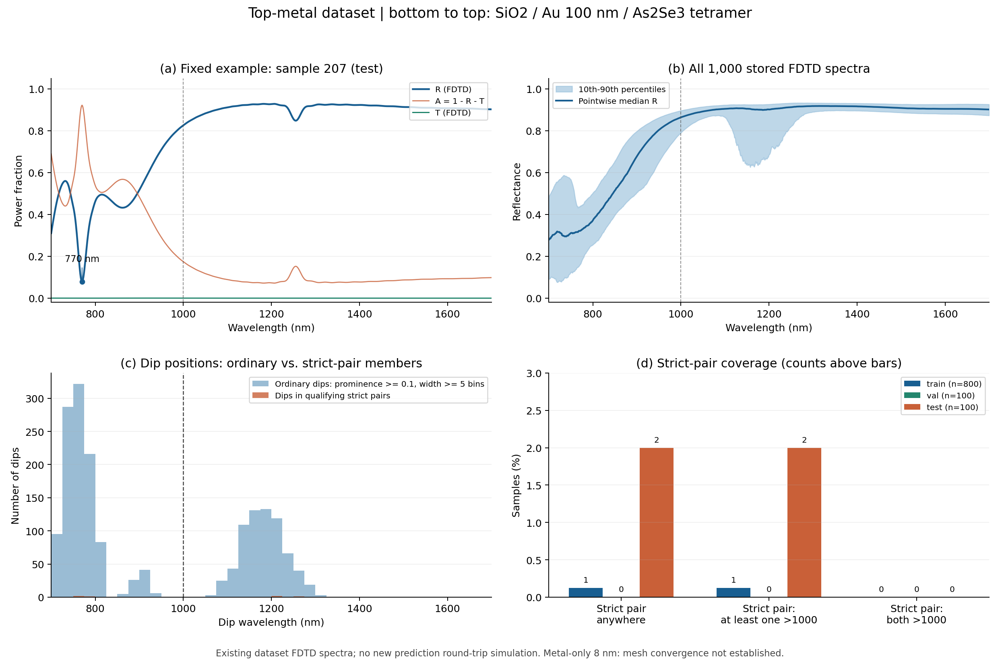
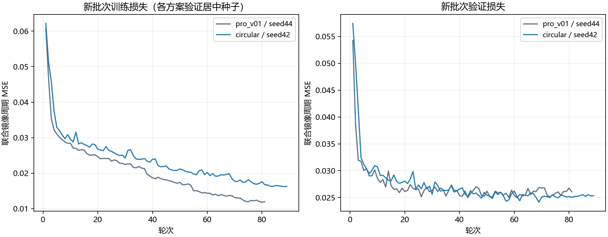
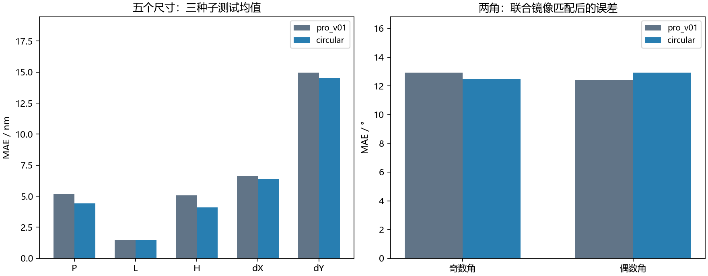
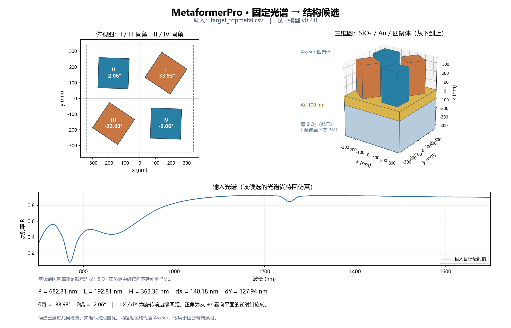

# MetaformerPro：新层序1000样本训练与验证

2026-10-24汇总；训练于2026-10-23完成。独立分支 `codex/metaformerpro-topmetal-1000`。这次只使用新数据，两个输出头均从随机初始化训练，未复用旧层序权重。

验证规则选中 **circular，seed 42**。所选方案三种子平均镜像等价测试MSE为 **0.025325**，比训练集标签均值常数基线低 **69.5%**。这是本批数值数据内的比较，不与旧物理体系测试误差直接比较。

## 数据查收

1000/1000个样本，固定800训练/100验证/100测试；样本ID、原始NPZ、汇总数组、配置及材料身份核验见 [data_audit.json](data_audit.json)。数据SHA256：`bc0f21a90ed7dcb3a228c81dfef023a0425cfed618a8bc275cc6487b4430621d`。

层序自下而上：延伸至下PML的厚SiO₂、100 nm JC Au、As₂Se₃四聚体。金属区域z=-100..0 nm，柱体z=0..H，T监视器在SiO₂内。Au使用2.2.0的修正被动模型；金层z网格约7.733 nm，其他区域自动网格。全部达到自动关断，质量仍为pipeline_validation，未据此认定网格精度收敛。

## 光谱覆盖

有 **691/1000** 条光谱在1000 nm以上存在普通明显谷，但按原先固定的严格双主谷标准，只有 **3/1000** 条合格，且 **没有一条两个主谷都在1000 nm以上**。普通谷与严格双主谷是不同统计，不能混用。当前几何范围并未充分覆盖长波双主谷目标，仅增加同范围的随机样本不能保证解决这一问题。

普通谷：突出度≥0.1、半突出度宽度≥5个采样间隔。严格配对还要求各谷R≤0.2、突出度≥0.4、距波段边界>30 nm，谷间距≥30 nm、谷间隆起与较浅谷的反射率差≥0.2。枚举所有合格配对后统计，未只检查每条谱最强的一对。

| 分割 | 样本数 | 严格双主谷 | 两主谷均>1000 nm | 至少一个普通谷>1000 nm |
|---|---:|---:|---:|---:|
| train | 800 | 1 | 0 | 551 |
| val | 100 | 0 | 0 | 74 |
| test | 100 | 2 | 0 | 66 |

逐谱结果见 [spectral_coverage.json](spectral_coverage.json)。该统计描述输入数据，不使用模型测试误差筛选展示样本。样本207预先固定作界面演示，只有一个满足普通阈值的谷（约770.07 nm），未作双谷、最佳结构或最佳预测的宣称。半突出度宽度不等同于模态线宽，未由此计算Q。



## 训练和选择

现有两个头：Sigmoid七输出、圆周角度输出；骨干均为4层96维，约32万参数。每个方案3种子，batch8，AdamW学习率3e-4，最多100轮、20轮无足够改善早停。标准化只使用800条训练谱。未在本轮增加新网络模块或容量扫描。

先要求五尺寸验证MSE不超过Sigmoid基线的1.02倍、dX MAE不超过其1.05倍，再选三种子平均镜像验证误差最低者，部署种子取该方案验证表现居中者。选择在本轮测试评估前冻结；两种头均按预先计划报告测试结果，不据测试结果更换选择。

| 方案 | 镜像验证MSE | 五尺寸验证MSE | dX MAE/nm | 通过尺寸门槛 |
|---|---:|---:|---:|---|
| circular | 0.024448 | 0.021820 | 5.844 | True |
| pro_v01 | 0.024951 | 0.021992 | 5.942 | True |



| 方案 | 种子 | 最佳轮 | 总轮数 | 总耗时/秒 |
|---|---:|---:|---:|---:|
| pro_v01 | 42 | 19 | 39 | 81.4 |
| pro_v01 | 43 | 15 | 35 | 72.1 |
| pro_v01 | 44 | 61 | 81 | 154.2 |
| circular | 42 | 69 | 89 | 177.9 |
| circular | 43 | 31 | 51 | 99.2 |
| circular | 44 | 40 | 60 | 111.0 |

## 测试结果

| 方案 | 原始标签周期MSE | 镜像等价MSE | 五尺寸MSE |
|---|---:|---:|---:|
| pro_v01 | 0.036227 | 0.026211 | 0.024485 |
| circular | 0.034444 | 0.025325 | 0.022949 |

圆周头相对Sigmoid头，三种子平均镜像等价测试MSE降低 **3.4%**，五尺寸MSE降低 **6.3%**。奇数角MAE降低约0.44°，偶数角MAE增加约0.53°，并非所有指标都改善。dY误差仍接近训练均值常数预测，说明该参数尚未被可靠辨识。

训练均值常数基线的镜像等价MSE：0.083127。三种子均值用于方案比较，部署仍为单个验证选中的种子。

| 参数 | Sigmoid头 MAE | 圆周头 MAE | 单位 |
|---|---:|---:|---|
| P | 5.182 | 4.412 | nm |
| L | 1.438 | 1.434 | nm |
| H | 5.076 | 4.109 | nm |
| dX | 6.649 | 6.394 | nm |
| dY | 14.962 | 14.527 | nm |
| 奇数角 | 12.921 | 12.476 | ° |
| 偶数角 | 12.397 | 12.931 | ° |



部署权重在100条测试结构中的合法数为 100/100；CPU重载与保存预测最大归一化差为 8.87e-07。训练标准化、样本ID、层序和数据身份检查通过。几何合法不代表已经复现目标光谱；本轮未运行新FDTD。

## 固定光谱到结构

PyCharm打开 `D:/projects/MetaformerPro_topmetal/Metaformer_As2Se3`，解释器 `D:/Anaconda3/envs/transformer_env/python.exe`。运行项16训练新批次；运行项17使用 `models/metaformerpro_topmetal.pt` 和 `inputs/target_topmetal.csv`，保存参数和正确层序的示意图。

```powershell
python train_metaformerpro.py all --config configs/metaformerpro_topmetal1000.json
python analyze_topmetal_spectra.py
python summarize_topmetal1000.py
python predict_metaformerpro.py --checkpoint models/metaformerpro_topmetal.pt --spectrum inputs/target_topmetal.csv --output results/topmetal1000/prediction_207.json --show
```



原始新数据包保持在用户提供的D盘目录；项目仅复制约10 MB汇总及任务配置。旧数据与旧权重保留。模型输出为候选结构，目标谱能否由其实现仍需后续电磁回验。
