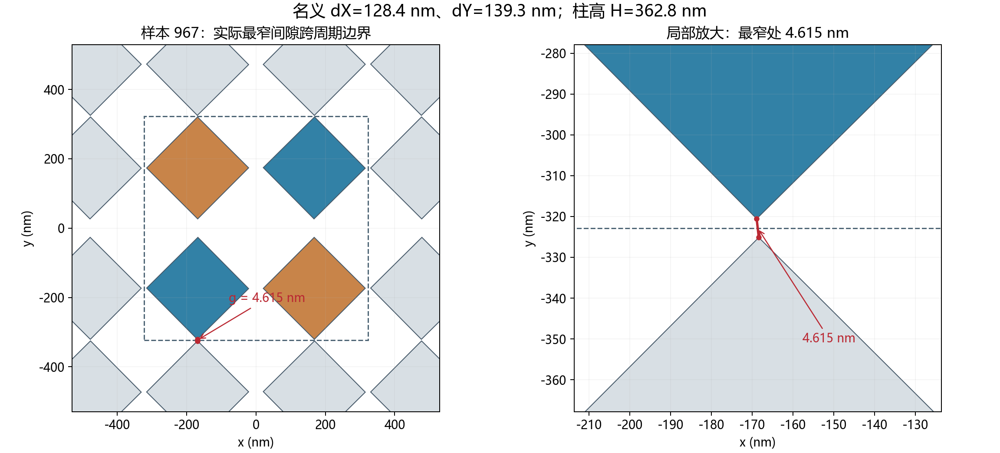

# MetaformerPro：光谱信息、特征表达与真实加工间隙

2026-10-27。本次只调研文献、复核已有训练证据并计算几何距离，没有新增神经网络训练或 FDTD。原模型和生成器均未修改。

**目前有理由关注可辨识性与加工约束，不能把误差全部归因于网络层数或样本量。** 某些谱差异可能尚未被网络充分利用；但镜像同谱和低于数值误差的变化，不能靠 FFT、加深网络或增加同类样本消除。另一方面，名义 dX、dY 并不是旋转后的最小开口，现有批次确实包含很难直接送加工的几何。

## 1. 实际沟道究竟有多窄

对象为已完成的生成器 2.2.0 新层序 1000 条数据：厚 SiO₂ / Au 100 nm / As₂Se₃ 四聚体。数据 SHA256 为 `bc0f21a90ed7dcb3a228c81dfef023a0425cfed618a8bc275cc6487b4430621d`。本报告的距离统计覆盖全部 1000 条，不以训练/测试划分筛选样本。

按实际旋转后的四个正方形计算多边形之间的欧氏最短距离，同时检查单元内部和周围八个周期单元。中心坐标为 `±(L+dX)/2`、`±(L+dY)/2`；dX、dY 是未旋转时的名义间距。算法用顶点到边投影双向取最小值，并用未旋转、共同旋转 45° 的解析例子及最窄样本的最近点核对。数值见 [actual_gap_statistics.json](actual_gap_statistics.json)；距离函数沿用仓库中的 [audit_manufacturability.py](../../scripts/audit_manufacturability.py)。

| 范围 | 最小值 / nm | 中位数 / nm |
|---|---:|---:|
| 同一个周期单元内 | 13.876 | 69.538 |
| 跨周期单元 | 4.615 | 112.891 |
| 两者合并后的真实最小间隙 | **4.615** | **67.696** |

| 真实最小间隙阈值（累计） | 样本数 / 1000 |
|---|---:|
| <20 nm | 10 |
| <50 nm | 190 |
| <80 nm | 697 |
| <100 nm | 929 |

这些只是描述性分界，不是已获工艺平台认证的加工极限。若暂用 ≥80 nm、≥100 nm 进行讨论，分别有 303、71 条符合；不能据此直接宣布它们均可加工。

**最窄的是 967 号样本，发生在相邻周期单元之间。** 其 P=645.702 nm、L=207.870 nm、H=362.794 nm，名义 dX=128.368 nm、dY=139.275 nm，奇/偶角约 +44.705° / −44.906°，但周期边界附近的真实开口只有 4.615 nm。仅检查四聚体内部会漏掉这个限制。

这里是局部角点之间的窄开口，不能把它当作整条均匀宽度 4.6 nm 的矩形深槽。H/g≈78.6 只说明局部拥挤程度。作为几何敏感性示例，若顶面尺寸和中心固定、侧壁从竖直向外倾斜 β，底边长为 `L_bottom=L_top+2H tan(β)`；在这一假设下，967 号仅 β=1° 就会在底部跨周期接触。这个角度是假设值，并非实测 As₂Se₃ 工艺数据。

**不能把整批最窄样本套到当前演示候选上。** 固定输入 207 号的三个结构如下；后两者仍是尚未做 FDTD 回验的网络候选。

| 结构 | 高度 / nm | 真实最小间隙 / nm | 假设底部外扩 2° 后 / nm |
|---|---:|---:|---:|
| 数据集原始 207 | 355.18 | 67.98 | 38.42 |
| 现用 4 层网络输出 | 362.36 | **91.37** | 61.29 |
| 实验 12 层网络输出 | 361.57 | **117.21** | 91.77 |

这些候选比最窄样本宽裕，但侧壁形状、圆角、残留和刻蚀终点仍会影响实际开口；表格不构成良率保证。4.615 nm 也小于当前约 7.8 nm 的横向网格，是数值敏感性线索；仅凭这一比较，不能断言共形网格完全不能表示它，或整批光谱都无效。

## 2. 文献能证明哪些加工能力

| 一手来源 | 已展示的结果 | 对本器件的证据边界 |
|---|---|---|
| [Tzadka Shalit 等，Optics Express 2022，DOI 10.1364/OE.462448](https://schvartzmanlab.com/wp-content/uploads/2022/08/2022-tzadka-opt.-exp.pdf) | 通过溶剂辅助纳米压印，在 As₂Se₃ 表面形成 20 nm 线宽、200 nm 周期图形 | **20 nm 线宽不是 20 nm 空隙**；没有证明 Au 上约 300 nm 高柱间深窄开口的可重复加工 |
| [Gu 等，Opto-Electronic Science 2024，DOI 10.29026/oes.2024.240017](https://einstein.nju.edu.cn/upload/kindeditor/file/20241113/20241113170529_5125.pdf) | EBL、Cr 硬掩膜和 ICP 在块体 As₂Se₃ 上刻出约 8 μm 高柱；柱径为微米尺度 | 证明该材料可深刻蚀，不能外推为纳米级开口已成熟；文章也提示去 Cr 掩膜需避免损伤 As₂Se₃ |
| [Popescu 等，Chalcogenide Letters 2020](https://chalcogen.ro/117_PopescuAA.pdf) | 玻璃 / 46 nm Au / 连续 As₂Se₃ 膜的实验 SPR | 支持 Au 上制备连续 As₂Se₃ 膜的先例；没有验证独立纳米柱、Au 刻蚀终点或窄开口良率 |
| [Piggott 等，Scientific Reports 2017](https://www.nature.com/articles/s41598-017-01939-2) | 将制造约束直接纳入逆向设计，并在硅光平台实测器件 | 支持“先限制设计空间”的方法，不能借用硅工艺尺寸作为 As₂Se₃/Au 工艺承诺 |

**结论：目前查到的证据不足以支持整批结构可直接加工，尤其不能支持 4.6–20 nm 的这类深窄局部开口。** 约 90–120 nm 的候选更适合作为与工艺平台讨论的起点。最终最小间隙应由目标平台在实际 As₂Se₃ 膜厚、Au 底层和掩膜条件下的小面积试刻确定；关注底部残留、侧壁角、圆角、Au 损伤和尺寸偏差，不能只看电子束曝光分辨率。

现有几何合法性检查要求不相交、位于周期单元内，却没有工艺最小间隙。后续应同时约束旋转后的同单元间隙与跨周期间隙，并将侧壁/圆角等实际几何纳入最终回验。这里只提出修改方向，未擅自改变当前生成器。

## 3. “信息不足”和“特征不明显”需要分开

| 情况 | 当前证据 | 能做什么、不能做什么 |
|---|---|---|
| 全局多解 | 已有一个受控镜像对照中，`(θ奇,θ偶)→(−θ偶,−θ奇)` 的反射率最大差约 1.71×10⁻⁸ | 应承认等价结构；不能要求单条同谱输入唯一恢复两个原始角标签 |
| 参数响应弱或互相抵消 | 训练集 dY 对单个波长的最大绝对线性相关系数仅 0.106；当前 dY 验证 MAE 13.79 nm，常数基线约 14.49 nm | 提示当前观测下信息提取有限，但低线性相关不能证明不存在非线性信息 |
| 目标覆盖不足 | 严格双主谷仅 3/1000 条；其中两个谷均 >1000 nm 的为 0 条；普通长波谷与严格双主谷不是同一计数 | 重新编码不能补出数据未覆盖的目标区域 |
| 数值变化可能遮盖弱信号 | 既有单个完整器件的 8/4 nm、4/2 nm 金属局部网格对照尚不一致 | 不能把低于数值不确定性的变化都当成可靠几何信息；也不能将该样本的误差数值套给全部样本 |
| 网络与训练配方 | 12 层相对 4 层验证误差降 2.8%，但既有测试误差升 6.3% | 单纯加深本轮没有取得可靠泛化改善；不足以单独确定误差主因 |

本节沿用 [镜像与网格对照](../2026-10-22_rotation_jc220/README.md)、[信号诊断与优化](../2026-10-27_metaformerpro_refine/README.md)、[深度对照](../2026-10-27_metaformerpro_depth/README.md)，没有增加新实验。测试集已多次查看，后续比较也不能称为新增盲测。

逆向纳米光子文献已经讨论了多种结构对应相似光谱导致标签冲突的问题。[Liu 等，ACS Photonics 2018](https://arxiv.org/abs/1710.04724) 支持这一判断，但其串联网络方法不是本次默认方案，也没有据此恢复用户暂缓的正向网络。

进一步诊断可采用参数范围归一化后的响应雅可比矩阵，比较各列强度及其相关性，再用数值/测量误差加权。弱列意味着灵敏度不足，近共线列意味着参数变化容易互相补偿。[NIST 的散射测量不确定度分析](https://tsapps.nist.gov/publication/get_pdf.cfm?pub_id=901617) 给出了这一类局部推断框架。未建立可信误差尺度前，只宜用它做相对比较；局部满秩也不能消除全局镜像多解。

### 增加独立观测比变换已有光谱更有机会补信息

多波长、角度和 Mueller 矩阵的联合测量已有降低参数相关性的实验先例，见 [Gödecke 等，Light: Advanced Manufacturing 2021](https://www.light-am.com/en/article/doi/10.37188/lam.2021.018)。但我们器件应先用少量受控对照确认哪个通道有用，再考虑增加大批数据。

不能简单保证“再加 y 偏振就解决角度镜像”。依据平面镜像对 Jones 矩阵的变换，固定实验室 x/y 基底中，同偏振复振幅可保持相同，交叉偏振复振幅改变符号；只测交叉通道强度仍可能相同。这是结合 [Menzel 等的对称性框架](https://arxiv.org/pdf/1008.4117) 对本结构的物理推断，不是本次新仿真结果。需要验证偏振混合后的相干信息、适当方位的斜入射或完整 Jones/Mueller 观测是否真正打破目标等价。仅增加 Rxx 的相位也未必够用。

R、T、A 中 `A=1−R−T`，不能算三个独立观测。当前 Au100 的透射很弱，是否能提供可靠额外信息，要对其绝对精度核对。

## 4. 编码怎样改，才有明确目的

**建议保留全谱背景和绝对波长位置，再让共振附近获得更细的表达。** 现有分块嵌入不等于已经证明丢失谷信息；改编码仍需与相同骨干、相同划分的原始谱基线对照。

1. 全谱继续作为主输入；根据输入谱检测局部谷，提取覆盖中心、两侧斜率和背景的局部片段。局部坐标需同时保留绝对中心波长及波长跨度，避免把不同位置的谷缩放成一样。
2. 可将局部频率、深度、非对称程度和拟合宽度作为辅助表达，保留拟合残差与原曲线。不能强制每条谱都有两个明确模式，或只用少数谷参数替代全部光谱。
3. 参数敏感度若用于选择波段，必须在训练数据或独立设计的对照上确定；推理阶段只依赖输入谱。不能拿测试结构标签选择其“最有信息”的窗口。

共振参数化已有直接相关先例：[Ma 等的 RIDL 作者稿](https://arxiv.org/abs/2105.03001) 将共振形状分解、模式信息和学习结合，用于高 Q 谱的表达。因此，“谷特征输入”本身不能直接声称原创。我们可探索它与实际可观测性、几何制造约束的结合，但性能和创新性均需进一步验证。

[Fan 等的 Fano 时域耦合模理论](https://web.stanford.edu/group/fan/publication/Fan_JOSAA_20_569_2003.pdf) 提供共振与直接背景路径的物理解释。实际 Au 有吸收，强度反射谱并不保证能唯一拆出辐射/吸收损耗；半突出度宽度也不能直接视作模式线宽后宣称 BIC/Q。需先确认模式及拟合模型适用性。

FFT 或导数可以改变有限网络学习特征的难易，但不能产生新测量信息。完整复数 FFT 可逆，若只留幅度会丢失相位，对位移的辨识还可能变差。[Feldman 等，Nature Communications 2025](https://doi.org/10.1038/s41467-025-66187-9) 的 Fourier scatterometry 指远场角度/k 空间观测，并非对一条 R(λ) 做 FFT；其有限硅结构实验不能直接等同于本周期阵列。

建议下一步顺序为：**先确定加工可接受的几何域，再比较噪声尺度下哪些观测能区分七个参数，最后在固定小骨干上检验共振局部编码。** 如果最终部署只输入一条 R(λ)，目标应允许输出满足光谱与加工条件的等价候选；不能承诺所有七个原始标签均唯一可逆。本次到此结束，未启动上述后续计算。
