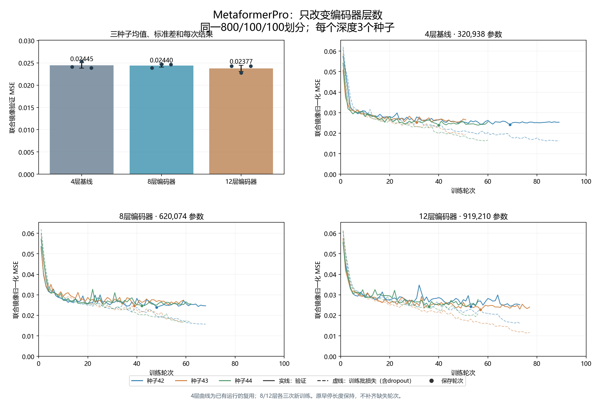
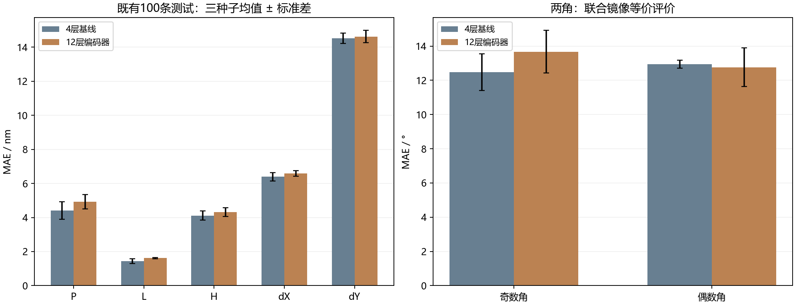
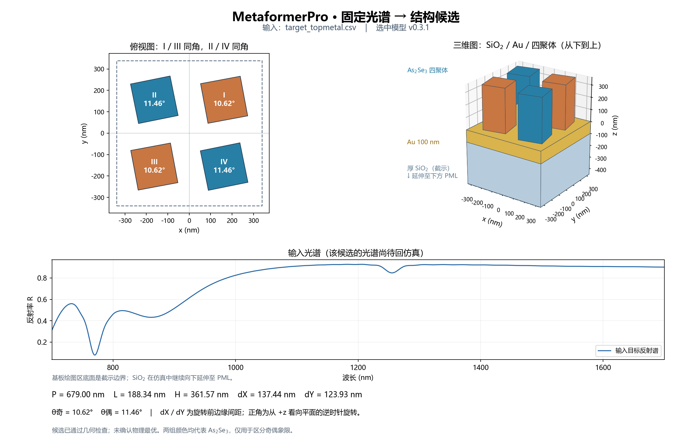

# MetaformerPro：4 / 8 / 12层编码器对照

2026-10-27。独立分支 `codex/metaformerpro-depth-study`，工作树 `D:/projects/MetaformerPro_depth/Metaformer_As2Se3`。

验证集按预设规则选中 **12层编码器，seed 44**。三种子平均镜像测试MSE相对4层增加6.3%，五尺寸MSE增加5.6%。 测试未复现验证改善，本轮未据测试结果再改选其它深度。12层权重作为实验候选保留，现用4层权重不覆盖。

## 对照设置

本轮只改变编码器层数。4层基线复用同一数据上已训练的42/43/44三个种子；8层和12层各从随机初始化训练三个种子，共六次新训练。三组均为96维嵌入、4个注意力头、192维前馈层、圆周角度输出、原始0.02标准差下限、dropout 0.1。训练仍为AdamW、batch8、学习率3e-4、weight decay 0.001，最多100轮，20轮无足够改善早停。

数据仍为生成器2.2.0的1000条修正材料与层序数据，固定800训练/100验证/100测试，SHA256：`bc0f21a90ed7dcb3a228c81dfef023a0425cfed618a8bc275cc6487b4430621d`。层序为厚SiO₂ / 100 nm被动JC Au / As₂Se₃四聚体，SiO₂延伸至下PML。金属局部8 nm网格的数据质量仍为 `pipeline_validation`；本轮没有新增FDTD或正向网络。输入预处理统计仅用800条训练谱拟合。

预设验证选型条件：三种子平均联合镜像验证MSE至少降低1%；五尺寸验证MSE最多增加2%，dX MAE最多增加5%，dY MAE最多增加2%。合格者中选验证误差最低的深度，以该深度验证表现居中的种子保存推理候选；无合格者则保留4层。**验证选择冻结后，仅评估4层基线和被选中的方案。** 这100条测试此前已被查看，本轮属于既有测试集上的重复比较，不是新增盲测。

## 验证与收敛

| 深度 | 参数量 | 保存权重训练eval MSE均值 | 镜像验证MSE均值 ± 种子标准差 | 五尺寸验证MSE | dX MAE/nm | dY MAE/nm | 尺寸门槛 / 1%改善 |
|---|---:|---:|---:|---:|---:|---:|---|
| 12层编码器 | 919,210 | 0.018922 | 0.023774 ± 0.000708 | 0.021780 | 5.936 | 13.681 | 是 / 是 |
| 8层编码器 | 620,074 | 0.018819 | 0.024404 ± 0.000374 | 0.021692 | 6.217 | 13.558 | 否 / 否 |
| 4层基线 | 320,938 | 0.018951 | 0.024448 ± 0.000623 | 0.021820 | 5.844 | 13.791 | 是 / 否 |



六次新训练合计24.5分钟，不包含复用的4层训练与脚本整理。三种子标准差仅描述训练随机性，不是物理精度置信区间。

| 深度 | 种子 | 保存轮次 | 总轮数 | 训练秒数 | 来源 |
|---|---:|---:|---:|---:|---|
| 4层基线 | 42 | 69 | 89 | 177.9 | 复用已有运行 |
| 4层基线 | 43 | 31 | 51 | 99.2 | 复用已有运行 |
| 4层基线 | 44 | 40 | 60 | 111.0 | 复用已有运行 |
| 8层编码器 | 42 | 48 | 68 | 211.7 | 本轮新训练 |
| 8层编码器 | 43 | 39 | 59 | 185.5 | 本轮新训练 |
| 8层编码器 | 44 | 42 | 62 | 204.9 | 本轮新训练 |
| 12层编码器 | 42 | 53 | 73 | 307.9 | 本轮新训练 |
| 12层编码器 | 43 | 57 | 77 | 325.7 | 本轮新训练 |
| 12层编码器 | 44 | 36 | 56 | 235.7 | 本轮新训练 |

表中训练eval和验证误差来自同一个保存权重，口径一致；曲线虚线为含dropout的逐轮训练批损失。训练损失继续降低而验证平台时，应按保存轮次评价，不能把末轮训练损失当作泛化提升。本轮结果只说明这些深度在固定配方和当前数据上的表现，不能单独证明样本量是误差主因，也不能排除其它训练配方的影响。

## 冻结后的测试

| 深度 | 原始标签周期MSE | 镜像等价MSE | 五尺寸MSE |
|---|---:|---:|---:|
| 4层基线 | 0.034444 | 0.025325 | 0.022949 |
| 12层编码器 | 0.035540 | 0.026911 | 0.024225 |

| 参数 | 4层基线MAE | 冻结选择MAE | 单位 |
|---|---:|---:|---|
| P | 4.412 | 4.919 | nm |
| L | 1.434 | 1.619 | nm |
| H | 4.109 | 4.316 | nm |
| dX | 6.394 | 6.584 | nm |
| dY | 14.527 | 14.625 | nm |
| 奇数角 | 12.476 | 13.671 | ° |
| 偶数角 | 12.931 | 12.760 | ° |



以上为三种子平均；实验候选推理使用单个seed 44。两角按同一个联合镜像代表计算周期误差，原始标签周期MSE同时保留。候选种子的100条测试结构中100/100通过几何检查，CPU与保存测试预测最大归一化差为1.07e-06，训练集标准化检查通过。参数误差与几何合法性不代表候选已复现输入光谱，本轮没有候选FDTD回验。

## 使用

原4层权重保留；本轮冻结候选为 `models/metaformerpro_depth.pt`，SHA256：`6c6c8c4f659c26b3f0c3f65dbeb7ed3d0f92fc8bfc8d031b4f136253642468fe`。PyCharm使用 `D:/Anaconda3/envs/transformer_env/python.exe`；运行项20执行本轮深度对照，运行项21读取 `inputs/target_topmetal.csv` 并展示实验候选结构。运行项17继续使用原4层模型。推理JSON的 `model_config` 明确记录层数和宽度。输入仍要求700–1700 nm等间距1000点，反射率0–1。

```powershell
python train_metaformerpro_refine.py all --config configs/metaformerpro_topmetal_depth.json
python summarize_metaformerpro_depth.py
python predict_metaformerpro.py --checkpoint models/metaformerpro_depth.pt --spectrum inputs/target_topmetal.csv --output results/topmetal_depth/prediction_207.json --show
```

207号仍是固定界面示例，没有按测试误差挑选“最佳”结构。图中的光谱为输入目标曲线。



原始逐运行数据见 [validation_results.json](validation_results.json)、[selection.json](selection.json)、[test_metrics.json](test_metrics.json)、[verification.json](verification.json)。
