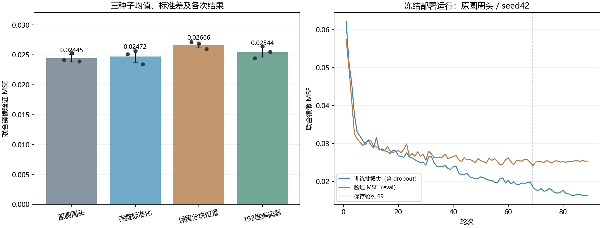
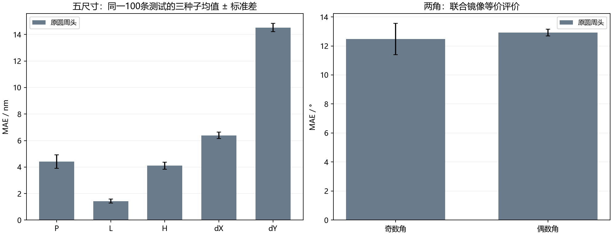

# MetaformerPro：新层序数据上的进一步优化

2026-10-27。分支 `codex/metaformerpro-topmetal-refine`，独立工作树 `D:/projects/MetaformerPro_refine/Metaformer_As2Se3`。

本轮三个候选均未满足预设替换门槛，**继续采用原圆周角度头**。`models/metaformerpro_refined.pt` 保存被保留的基线权重，部署版本仍为0.2.0；原文件也继续保留。

这轮只优化“反射谱→七个结构参数”的逆向模型。冻结选择后只测试基线和被选中的方案，不把没有胜出的候选逐一送到测试集继续挑选。原有100条测试样本已在前几轮查看过，**这是既有测试集上的重复比较，不是新增盲测**。三种子波动表示训练随机性，不是物理精度的置信区间。

## 数据和诊断

沿用同一1000条生成器2.2.0数值数据，固定800训练/100验证/100测试。数据SHA256：`bc0f21a90ed7dcb3a228c81dfef023a0425cfed618a8bc275cc6487b4430621d`。层序自下而上为厚SiO₂、100 nm被动JC Au、As₂Se₃四聚体，基板延伸至下PML，采用金属局部8 nm网格。材料、层序和逐样本完整性核验沿用[上一轮报告](https://github.com/CypherZzzyer05/Report/tree/main/reports/2026-10-24_metaformerpro_topmetal1000)。本批仍为 `pipeline_validation`，没有新增FDTD或网格收敛论证。

仅用训练/验证的[轻量诊断](signal_diagnosis.json)发现：1300–1700 nm有377/400个点受到原0.02标准差下限影响，但最小归一化标准差仍为0.658；降低下限的岭回归没有改善验证结果。dY与单个波长的训练集最大线性关联仅 |r|=0.106。这些结果提示dY的可提取信号较弱，不能据此证明物理上无法辨识，也不能把全部误差归因于归一化。

补充比较只在800条训练标签上拟合一个常数角对，验证集镜像等价角MAE已可达到 **15.09° / 15.89°**，这部分改善并没有使用光谱。因而，相对原始角均值常数的全部提升不能都解释成网络学到了角度信息。同一α的圆周岭回归中，固定联合镜像代表使镜像验证MSE从0.029702降至0.027431；同时原始标签周期MSE变差，两种评价均保留在诊断JSON中。这是标签表示对照，不是本轮神经模型的性能提升。

原先严格双主谷标准在这批数据中仅覆盖3/1000条；两个严格主谷均>1000 nm的样本为0条。691条在1000 nm以上存在普通明显谷，两种计数不能混用。本轮优化不能补出训练数据未覆盖的长波双谷目标。

## 三项有限改动

| 方案 | 改动 |
|---|---|
| baseline | 上一轮96维、4层、圆周头，原始0.02标准差下限；沿用三个已有运行 |
| standardized | 标准差下限改为0.005，其他结构相同；检验弱长波缩放是否有帮助 |
| position_readout | 同样0.005下限，将100个波长分块位置保留到输出层，避免先池化为一个向量 |
| encoder192 | 同样0.005下限，编码维度96→192，层数不变；检验扩大骨干容量 |

三个候选各用42/43/44种子从随机初始化训练；AdamW、batch8、学习率3e-4、weight decay 0.001，最多100轮，20轮无足够改善早停。预处理统计只由800条训练谱拟合并写入权重。三个已有基线重新载入后的验证预测已与归档对齐。

替换基线要求：三种子平均联合镜像验证MSE至少降低1%；五尺寸验证MSE最多增加2%、dX MAE最多增加5%、dY MAE最多增加2%。在满足全部条件者中选平均验证MSE最低者，部署其验证表现居中的种子；没有合格者则保留基线。选择冻结后再评估既有测试集。

| 方案 | 参数量 | 保存权重训练MSE均值 | 镜像验证MSE均值 ± 标准差 | 五尺寸验证MSE | dX MAE/nm | dY MAE/nm | 尺寸门槛 / 1%改善 |
|---|---:|---:|---:|---:|---:|---:|---|
| baseline | 320,938 | 0.018951 | 0.024448 ± 0.000623 | 0.021820 | 5.844 | 13.791 | 是 / 否 |
| standardized | 320,938 | 0.021060 | 0.024715 ± 0.000949 | 0.022236 | 6.093 | 13.974 | 是 / 否 |
| encoder192 | 1,268,554 | 0.019830 | 0.025442 ± 0.000827 | 0.022832 | 6.039 | 13.860 | 否 / 否 |
| position_readout | 2,145,609 | 0.020116 | 0.026661 ± 0.000499 | 0.023780 | 6.093 | 14.447 | 否 / 否 |



## 收敛与训练验证差距

本轮新增九次训练合计15.1分钟；该数值不包含沿用的三次基线运行，也不包含脚本启动和图表整理。

| 方案 | 种子 | 保存轮次 | 总轮数 | 训练秒数 | 来源 |
|---|---:|---:|---:|---:|---|
| baseline | 42 | 69 | 89 | 177.9 | 沿用已有运行 |
| baseline | 43 | 31 | 51 | 99.2 | 沿用已有运行 |
| baseline | 44 | 40 | 60 | 111.0 | 沿用已有运行 |
| standardized | 42 | 35 | 55 | 144.4 | 本轮训练 |
| standardized | 43 | 27 | 47 | 94.1 | 本轮训练 |
| standardized | 44 | 42 | 62 | 130.2 | 本轮训练 |
| position_readout | 42 | 18 | 38 | 67.3 | 本轮训练 |
| position_readout | 43 | 18 | 38 | 53.5 | 本轮训练 |
| position_readout | 44 | 23 | 43 | 59.0 | 本轮训练 |
| encoder192 | 42 | 26 | 46 | 88.8 | 本轮训练 |
| encoder192 | 43 | 30 | 50 | 126.9 | 本轮训练 |
| encoder192 | 44 | 45 | 65 | 141.6 | 本轮训练 |

| 方案 | 保存权重训练eval MSE均值 | 验证MSE均值 | 验证−训练 |
|---|---:|---:|---:|
| baseline | 0.018951 | 0.024448 | +0.005496 |
| standardized | 0.021060 | 0.024715 | +0.003655 |
| position_readout | 0.020116 | 0.026661 | +0.006545 |
| encoder192 | 0.019830 | 0.025442 | +0.005612 |

上表在保存的同一权重上以eval模式比较训练与验证。正差距说明训练集拟合优于验证集，不能仅凭训练损失继续下降认定泛化继续改善。图中逐轮训练曲线是含dropout的批损失，与表中的保存权重eval误差不是同一口径；虚线标出最终保存轮次。

## 冻结后的测试

| 方案 | 原始标签周期MSE | 镜像等价MSE | 五尺寸MSE |
|---|---:|---:|---:|
| baseline | 0.034444 | 0.025325 | 0.022949 |

| 参数 | 保留模型的三种子平均MAE | 单位 |
|---|---:|---|
| P | 4.412 | nm |
| L | 1.434 | nm |
| H | 4.109 | nm |
| dX | 6.394 | nm |
| dY | 14.527 | nm |
| 奇数角 | 12.476 | ° |
| 偶数角 | 12.931 | ° |

长度按真实nm还原；两个角采用**同一联合镜像代表**后计算周期误差，没有分别为每个角挑选有利标签。表中为三个种子的平均，实际部署为单个seed 42；原始标签周期MSE同时保留，避免将对称等价评价误读为精确标签恢复。



部署种子的100条测试结构中，100/100通过几何检查。CPU推理与保存的测试预测最大归一化差为8.87e-07。训练集标准化检查通过。几何合法与参数MAE都不能证明输出候选已经复现目标光谱；本轮没有候选FDTD回验。

## 使用本轮权重

原有 `models/metaformerpro_topmetal.pt` 继续保留，本轮冻结输出单独保存为 `models/metaformerpro_refined.pt`，SHA256：`8950779ce4fd3f467cdc4334190650963735d31c0f1c613aa2a7edc1cd549dfb`。PyCharm在本项目中使用解释器 `D:/Anaconda3/envs/transformer_env/python.exe`，运行项19读取固定输入并展示结构；输入CSV仍要求700–1700 nm等间距1000点、反射率0–1。

```powershell
python train_metaformerpro_refine.py all
python summarize_topmetal_refine.py
python predict_metaformerpro.py --checkpoint models/metaformerpro_refined.pt --spectrum inputs/target_topmetal.csv --output results/topmetal_refine/prediction_207.json --show
```

207号继续作为预先固定的界面示例，不按本轮测试误差挑选“最佳”结构。目标谱是已有数据的输入曲线，模型输出仍为待回验候选。


逐运行指标、冻结选择及核验分别保存在 [validation_results.json](validation_results.json)、[selection.json](selection.json)、[test_metrics.json](test_metrics.json)、[verification.json](verification.json)。
