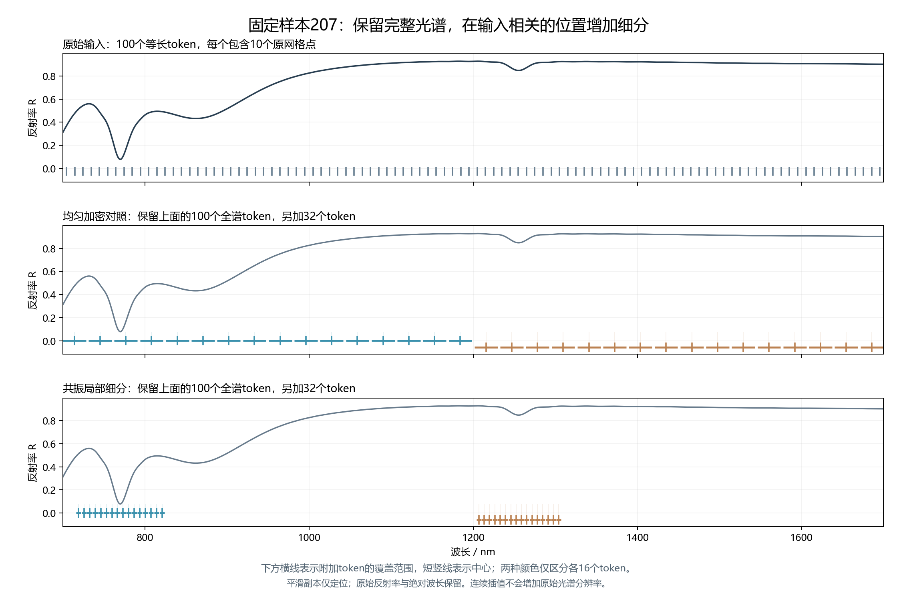
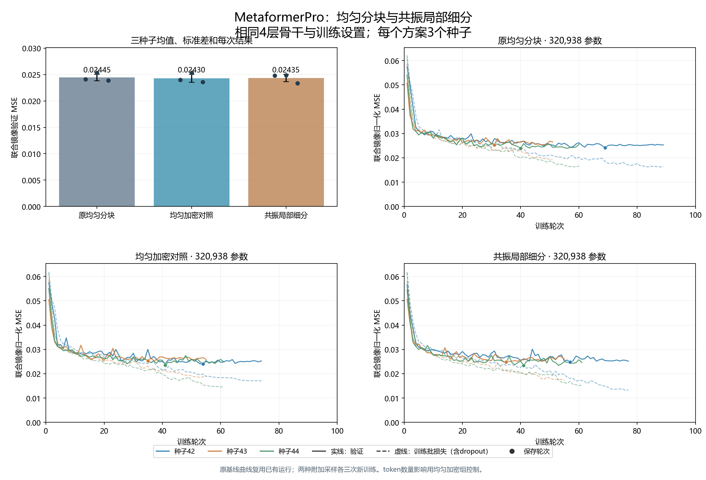
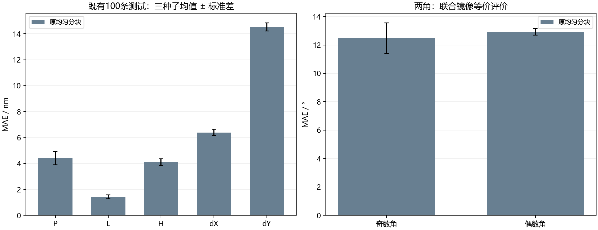
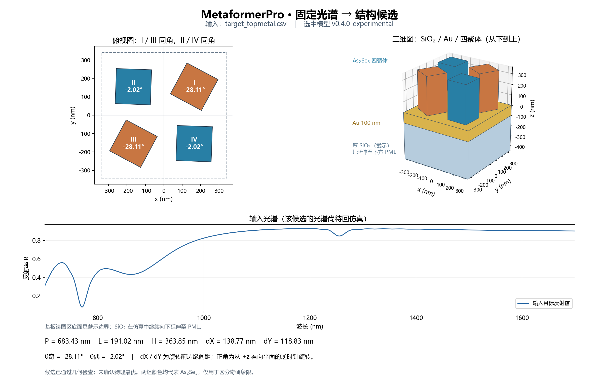

# MetaformerPro：共振局部细分输入编码试验

2026-10-27。独立分支 `codex/metaformerpro-resonance-tokenization`，工作树 `D:/projects/MetaformerPro_resonance/Metaformer_As2Se3`。原模型和生成器保留。

两种新输入编码均未满足预设替换条件，**继续保留现用原均匀分块模型**。本轮保存的冻结输出不是已证明有效的共振编码升级。

## 这次具体改变了什么

现用100个全谱token保留；新增两种132-token输入进行对照：均匀加密组在全波段附加32个token，共振组在输入谱的可信谷附近附加32个token。二者共用原Conv10投影和同一个4层编码器，均无新增可训练参数。每个附加token保留实际波长中心、覆盖宽度的固定位置编码。没有外接ResNet、LSTM或正向神经网络。

仅在平滑副本上定位谷和窗口；窗口内取原反射率。窗口最多围绕两个可信谷，不强制所有谱都有两个谷；缺谷时按预定均匀规则补足token。连续插值用于固定输入形状，不会增加原始约1 nm采样的物理分辨率。局部细分是假设能帮助有限网络提取已有形状差异，不能创造缺失信息或打破镜像同谱。

固定定位规则为11点三阶SG、谷显著度≥0.01、间隔≥20个原网格点；按显著度选最多两谷后按波长排序。窗口总跨度为半突出度宽度的4倍，截在16–240个原网格间隔内，边界仅裁剪。单谷的另一块为全域16token，无谷为全域32token。原始反射率不做局部深度归一化；中心、跨度及附加类型使用固定编码。算法选出的谷不等于已确认的物理模式，宽度也不作为Q值。



取样位置和跨度保存在 [sampling_207.json](sampling_207.json)。207号为此前固定的界面示例，不按本轮误差挑选。

## 数据与比较规则

沿用修正材料及层序的新1000条数据，固定800训练/100验证/100测试。数据SHA256：`bc0f21a90ed7dcb3a228c81dfef023a0425cfed618a8bc275cc6487b4430621d`。厚SiO₂ / 被动JC Au100 / As₂Se₃四聚体，基板延伸至下PML；金属局部8 nm网格，仍为 `pipeline_validation`，没有新增FDTD或网格收敛证明。

所有训练输入归一化统计只由800条训练谱拟合；谷窗口完全由当前输入谱确定，不使用真实几何或测试标签。3个种子均为42/43/44，维度96、编码器4层、注意力4头、前馈192、dropout0.1、圆周角度头；AdamW、batch8、学习率3e-4、weight decay0.001，最多100轮，20轮无足够改善早停。现用基线的三次已有运行复用，本轮新增6次训练。

验证门槛沿用：三种子平均镜像MSE至少降低1%，五尺寸MSE最多增加2%，dX MAE最多增加5%，dY MAE最多增加2%；合格者中选最低验证误差，以该方案验证表现居中的种子冻结候选。**只在选择冻结后评估原基线及被选中的方案。** 既有100条测试此前已经查看过，属于重复比较，不是新增盲测。没有根据本轮测试结果再选方案或种子。

## 验证结果

共振局部细分相对相同132个token的均匀加密组，三种子平均验证MSE增加0.2%；相对原100个token基线降低0.4%。这是当前数据和固定配方上的观察，不能仅凭单个种子或总loss判断其稳定优越性。 本轮未通过预设的共振取样机制门槛，尚未证实按谷分配优于均匀附加取样。

| 方案 | token数 | 参数量 | 保存权重训练eval MSE | 镜像验证MSE均值 ± 标准差 | 五尺寸验证MSE | dX MAE/nm | dY MAE/nm | 尺寸门槛 / 1%改善 |
|---|---:|---:|---:|---:|---:|---:|---:|---|
| 均匀加密对照 | 132 | 320,938 | 0.018850 | 0.024301 ± 0.000752 | 0.021879 | 6.111 | 13.704 | 是 / 否 |
| 共振局部细分 | 132 | 320,938 | 0.017867 | 0.024347 ± 0.000681 | 0.021746 | 5.981 | 13.459 | 是 / 否 |
| 原均匀分块 | 100 | 320,938 | 0.018951 | 0.024448 ± 0.000623 | 0.021820 | 5.844 | 13.791 | 是 / 否 |



新训练合计9.4分钟，不含复用基线和整理脚本。种子标准差描述训练随机性，不代表物理准确度置信区间。训练eval表格来自保存权重；曲线虚线是包含dropout的逐轮训练批损失，二者口径不同。

| 方案 | 种子 | 保存轮次 | 总轮数 | 训练秒数 | 来源 |
|---|---:|---:|---:|---:|---|
| 原均匀分块 | 42 | 69 | 89 | 177.9 | 复用已有运行 |
| 原均匀分块 | 43 | 31 | 51 | 99.2 | 复用已有运行 |
| 原均匀分块 | 44 | 40 | 60 | 111.0 | 复用已有运行 |
| 均匀加密对照 | 42 | 54 | 74 | 101.8 | 本轮新训练 |
| 均匀加密对照 | 43 | 35 | 55 | 75.3 | 本轮新训练 |
| 均匀加密对照 | 44 | 41 | 61 | 84.1 | 本轮新训练 |
| 共振局部细分 | 42 | 57 | 77 | 119.3 | 本轮新训练 |
| 共振局部细分 | 43 | 35 | 55 | 86.0 | 本轮新训练 |
| 共振局部细分 | 44 | 41 | 61 | 95.4 | 本轮新训练 |

## 冻结后的既有测试

| 方案 | 原始标签周期MSE | 镜像等价MSE | 五尺寸MSE |
|---|---:|---:|---:|
| 原均匀分块 | 0.034444 | 0.025325 | 0.022949 |

| 参数 | 原均匀分块MAE | 冻结候选MAE | 单位 |
|---|---:|---:|---|
| P | 4.412 | 4.412 | nm |
| L | 1.434 | 1.434 | nm |
| H | 4.109 | 4.109 | nm |
| dX | 6.394 | 6.394 | nm |
| dY | 14.527 | 14.527 | nm |
| 奇数角 | 12.476 | 12.476 | ° |
| 偶数角 | 12.931 | 12.931 | ° |



表格为三种子平均，单个推理候选使用seed 42。两个角共同选择同一个镜像代表，原始标签周期误差也保留。候选种子的100条测试结构中100/100通过几何合法性检查；该检查不等于满足最小加工间隙。CPU重载预测与归档结果最大归一化差为8.87e-07。几何合法和标签MAE不能证明候选已复现目标谱，本轮没有候选FDTD回验。

## 复现与使用

冻结输出：`D:\projects\MetaformerPro_resonance\Metaformer_As2Se3\models\metaformerpro_resonance.pt`，SHA256：`8950779ce4fd3f467cdc4334190650963735d31c0f1c613aa2a7edc1cd549dfb`。现用原权重不覆盖。输入仍为700–1700 nm、1000个等间距反射率点；同一输入定位规则用于训练与推理。

共振方案另保留验证表现居中的seed 42，文件为 `models/metaformerpro_resonance_candidate.pt`，仅供实验查看，不自动替换现用权重。该文件的身份及是否进入完整测试见 [experimental_candidate.json](experimental_candidate.json)。PyCharm运行项23加载此实验候选；运行项17继续加载现用模型。

本轮18项定向程序测试通过，覆盖采样/缺谷回退、绝对位置与跨度、梯度、132-token集成、旧模型兼容和权重重载。实验候选训练归一化与固定207号CPU/CUDA推理检查见 [candidate_verification.json](candidate_verification.json)。

```powershell
python train_metaformerpro_refine.py all --config configs/metaformerpro_topmetal_resonance.json
python summarize_resonance_study.py
python predict_metaformerpro.py --checkpoint models/metaformerpro_resonance_candidate.pt --spectrum inputs/target_topmetal.csv --output results/topmetal_resonance/prediction_207.json --show
```



此图读取另行保留的共振实验权重，不代表验证冻结方案已切换。输入谱来自已有数值数据，图中没有候选的FDTD回验曲线。

逐运行记录见 [validation_results.json](validation_results.json)、[selection.json](selection.json)、[test_metrics.json](test_metrics.json)、[verification.json](verification.json)。

代码、PyCharm运行项与权重已保存在 [Optics_design 的输入编码实验分支（1b31513）](https://github.com/CypherZzzyer05/Optics_design/tree/1b31513/Metaformer_As2Se3)。现用原模型文件未修改；实验候选的SHA256为 `c16acfe5dbe420500f0ad4f34b2ea75509fabcdba8a07c8ac971a9ad34b668bd`。
