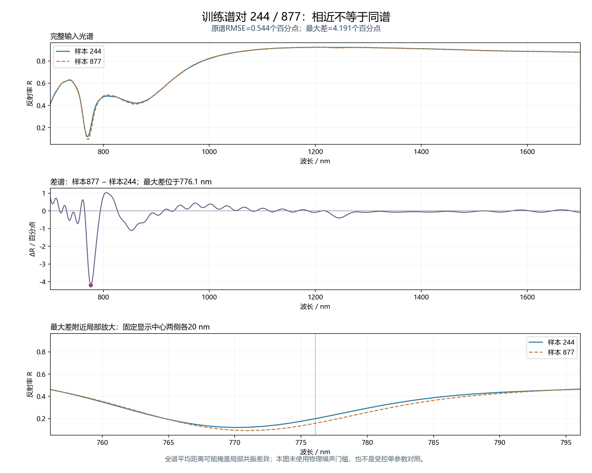
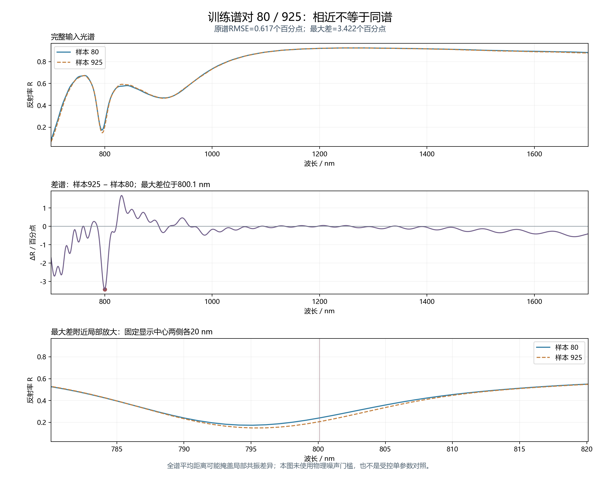

# 光谱近邻诊断：相近光谱下的结构差异

2026-10-27。仅使用修正材料及层序数据的800条训练和100条验证；没有读取测试索引或使用测试谱/标签。没有训练、FDTD或部署模型修改。数据SHA256：`bc0f21a90ed7dcb3a228c81dfef023a0425cfed618a8bc275cc6487b4430621d`。

**现用直接逆向网络的验证误差优于这两种1NN检索。** 本诊断没有把“给定光谱→结构”的任务改成查库，也没有据验证结果替换模型。它用于检查当前有限数据库里的光谱邻域和标签分散情况，不是本征不可辨识性或最优误差下界证明。

## 固定规则

- 原谱距离为1000点反射率差的RMSE，同时报告最大绝对差，避免全谱平均掩盖窄谷变化。
- 标准化距离用800条训练谱逐波长标准差，下限0.02，计算RMSE；均值在差分中抵消。计算为float64，标准差为总体口径 `ddof=0`，没有拟合验证统计。
- 训练内部1NN排除自身；验证1NN只查询训练库。两种距离分别展示，不按验证结果挑“最优距离”。
- 保持预测的奇/偶角顺序不变，给目标两角共同选择原代表或联合镜像 `(-θ偶,-θ奇)` 代表，再算90°周期差；五个长度不变。这与现网络 `spectral_inverse.parameter_errors` 的逐角MAE口径一致。七参MSE按原配置参数范围归一化。
- 两个示例分别按“全部训练谱对中原谱RMSE最小”和“ΔdY≥20 nm条件下原谱RMSE最小”选取。20 nm是已声明的示例筛选条件，不是物理可辨识阈值。最大差放大窗固定为中心两侧各20 nm。

## 邻域距离与验证比较

下表为800条训练谱各自最近邻距离的分位数。原谱距离单位是反射率，标准化距离无量纲。这些只是当前数据密度的描述，**不代表测量噪声或FDTD误差地板**。

| 距离定义 | 最小 | 1%分位 | 5%分位 | 中位数 | 95%分位 | 最大 |
|---|---:|---:|---:|---:|---:|---:|
| 原反射谱距离 | 0.005443 | 0.006796 | 0.009597 | 0.018987 | 0.035682 | 0.080726 |
| 训练集标准化距离 | 0.058025 | 0.084542 | 0.108244 | 0.206800 | 0.411189 | 0.958534 |

验证100条的七参数误差如下。网络列沿用 `results/topmetal1000/validation_results.json` 的三个圆周头种子，仅读取validation字段，没有运行新的模型评价。这100条验证数据此前已用于模型选型和早停，当前比较不是新的盲测；这里只比较两种预先固定距离的1NN，不代表所有检索方法。

| 诊断/模型 | 联合镜像MSE | P MAE/nm | L MAE/nm | H MAE/nm | dX MAE/nm | dY MAE/nm | 奇角MAE/° | 偶角MAE/° |
|---|---:|---:|---:|---:|---:|---:|---:|---:|
| 原反射谱距离 | 0.052627 | 12.237 | 3.532 | 11.526 | 9.182 | 19.425 | 15.930 | 15.172 |
| 训练集标准化距离 | 0.045165 | 9.160 | 2.196 | 7.953 | 9.282 | 17.863 | 15.653 | 14.404 |
| 现用网络（三种子均值） | 0.024448 | 4.608 | 1.266 | 4.077 | 5.844 | 13.791 | 13.210 | 12.554 |

两种1NN的dY误差为19.43、17.86 nm，现网络为13.79 nm。网络优于直接近邻检索，说明其性能不能等同于简单查库。1NN较差也可能来自稀疏采样及距离定义，并不是神经网络可达到精度的下界。

### 训练谱对 244 / 877

选择规则：全部训练谱对中原谱RMSE最小。原谱RMSE为 **0.544个百分点**，最大反射率差为 **4.191个百分点**，位于776.1 nm。较小的全谱平均差仍可伴随明显的局部差异，不能称为不可分辨或同谱。



| 参数 | 样本244原始值 | 样本877原始值 | 联合镜像后的绝对差 | 单位 |
|---|---:|---:|---:|---|
| P | 655.869 | 661.388 | 5.520 | nm |
| L | 199.688 | 199.935 | 0.247 | nm |
| H | 328.309 | 327.307 | 1.002 | nm |
| dX | 129.998 | 127.292 | 2.706 | nm |
| dY | 149.793 | 139.798 | 9.995 | nm |
| 奇数角 | -43.077 | 24.348 | 5.216 | ° |
| 偶数角 | -19.132 | -40.346 | 6.577 | ° |

两角共同选择目标（样本244）的原代表或镜像代表，再计算90°周期差，保持预测（样本877）的奇/偶坐标顺序，与现网络一致。表中前两列保留原始角标签，因此不能直接相减后与第四列混用。是否镜像目标：True。参数表另存为 [pair_244_877_parameters.csv](pair_244_877_parameters.csv)。
### 训练谱对 80 / 925

选择规则：在ΔdY≥20 nm的训练谱对中原谱RMSE最小。原谱RMSE为 **0.617个百分点**，最大反射率差为 **3.422个百分点**，位于800.1 nm。较小的全谱平均差仍可伴随明显的局部差异，不能称为不可分辨或同谱。



| 参数 | 样本80原始值 | 样本925原始值 | 联合镜像后的绝对差 | 单位 |
|---|---:|---:|---:|---|
| P | 678.843 | 679.880 | 1.037 | nm |
| L | 204.840 | 206.588 | 1.748 | nm |
| H | 363.533 | 366.040 | 2.507 | nm |
| dX | 135.077 | 132.243 | 2.833 | nm |
| dY | 94.117 | 131.085 | 36.967 | nm |
| 奇数角 | 43.582 | -31.625 | 38.938 | ° |
| 偶数角 | -7.313 | 36.016 | 10.401 | ° |

两角共同选择目标（样本80）的原代表或镜像代表，再计算90°周期差，保持预测（样本925）的奇/偶坐标顺序，与现网络一致。表中前两列保留原始角标签，因此不能直接相减后与第四列混用。是否镜像目标：True。参数表另存为 [pair_80_925_parameters.csv](pair_80_925_parameters.csv)。


## 能与不能得出的结论

在示例80/925中，P、L、H、dX差异相对较小，但dY和角度同时变化，不能把谱相近完全归因于dY不敏感。此类非受控样本只提示可能的参数补偿或有限样本邻域分散；稀疏的七维数据库、选择距离和数值误差也会影响观察。

本批仍为金属局部8 nm、`pipeline_validation` 数值数据，完整器件的网格精度未得到普遍收敛认证。这里没有把既有单个器件的网格误差套给全部样本，也没有设定一个未经验证的噪声地板。当前谱对的最大差达到数个百分点，不能据平均RMSE直接宣称同谱或实验不可分辨。

要判断单个参数是否缺少可靠信息，需要固定其余参数的物理对照，以及可信数值/测量误差尺度。当前结果不证明增加观测一定有效，也不证明单谱能够唯一恢复七参；已经验证的镜像等价与这里的近似谱邻域应分别解释。

## 复现与文件

```powershell
python diagnose_spectral_neighbors.py
```

使用现项目已有NumPy、Matplotlib和PyTorch，逐行误差核对调用既有 `spectral_inverse.parameter_errors`。脚本内含解析距离、非对称镜像偏差和周期角度自检；所选最小谱对距离另与逐点直接RMSE核对。两种距离的800条训练1NN与100条验证1NN均独立核对逐参数归一化误差，结果保存在 `error_convention_checks`。完整输出见 [summary.json](summary.json)、[train_1nn.csv](train_1nn.csv)、[validation_1nn_errors.csv](validation_1nn_errors.csv)、[validation_1nn_errors.json](validation_1nn_errors.json)。未修改模型或生成器。

代码与数据诊断归档见 [Optics_design 的独立诊断分支（e22746a）](https://github.com/CypherZzzyer05/Optics_design/tree/e22746a/Metaformer_As2Se3)。1800条训练/验证近邻的逐参数归一化误差，已与当前模型的联合镜像评价函数核对，最大差2.78×10⁻¹⁶。

## 后续物理验证所需的参考

2026-10-27本机检查时，可用物理内存约2.36 GiB，没有启动原生求解器。下一步需要的单样本全域4 nm、金属局部2 nm参考包已经在[10月22日网格报告](../2026-10-22_rotation_jc220/README.md)提供，代码入口和服务器命令均沿用该报告；本次核对包的SHA256仍为 `e67658d4433c43e042e5be30d788e0abbf0265d237b2b9f1aae80a085dfce5fb`。

该参考保持厚SiO₂ / Au100 / As₂Se₃层序、SiO₂延伸至PML、700–1700 nm波段和修正后的被动JC金模型。它用于核对既有基准器件在金属局部细化以外的离散误差，不能单凭一个新网格点认证全部结构收敛。当前尚未收到其完成结果，未宣称已有物理精度验证。
