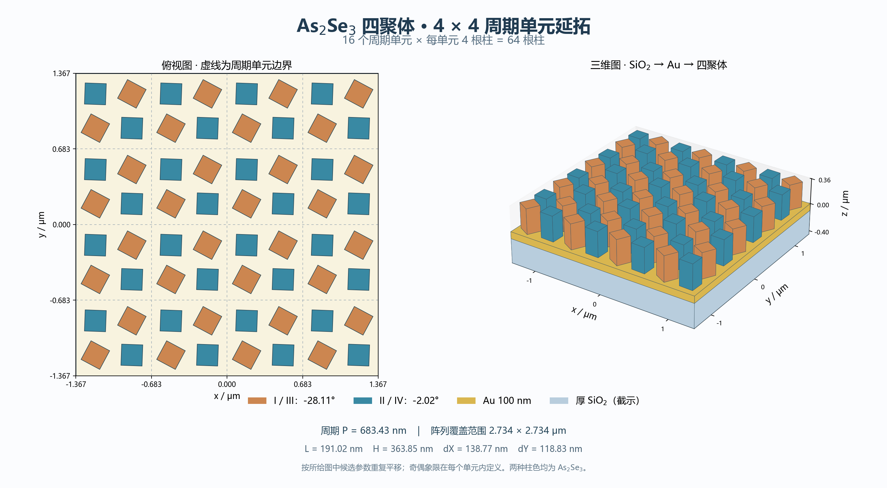

# 图中四聚体候选的4×4周期延拓

2026-10-28。按照用户提供图片对应的v0.4.0-experimental、seed42候选绘制；源参数保存在 [source_prediction.json](source_prediction.json)。此候选并非验证冻结后替换现用模型的方案，本页只展示其几何排布。

**4×4指4行、4列周期单元；每单元4根柱，共64根柱。** 单元中心平移为 `((i−1.5)P,(j−1.5)P)`，i、j分别取0、1、2、3；单元内部位置和旋转角保持不变。阵列覆盖范围为2.733720×2.733720 μm。

| 参数 | 数值 |
|---|---:|
| P | 683.430 nm |
| L | 191.023 nm |
| H | 363.851 nm |
| dX | 138.775 nm |
| dY | 118.827 nm |
| I/III旋转角 | −28.111° |
| II/IV旋转角 | −2.017° |
| Au厚度 | 100 nm |

从下到上为厚SiO₂、Au100 nm、As₂Se₃四聚体。两种柱色都代表As₂Se₃，只用于区分奇偶象限；象限在每个周期单元内部定义，正角为从+z俯视时逆时针。dX、dY仍是旋转前的名义边缘间距。

图中玻璃只截示350 nm厚，金膜和玻璃仅显示阵列覆盖区域；不能把截示底面当作厚基板的实际背面。本次只绘制几何延拓，没有进行有限4×4阵列的电磁求解，也没有改变服务器正在运行的单周期细网格参考。

64个柱体顶点均已与原模型的Geometry定义及对应周期平移核对一致。完整顶点与角度见 [array_geometry.json](array_geometry.json)，可缩放矢量图见 [array_4x4.svg](array_4x4.svg)。复现命令：`python scripts/draw_tetramer_array4x4.py`。
